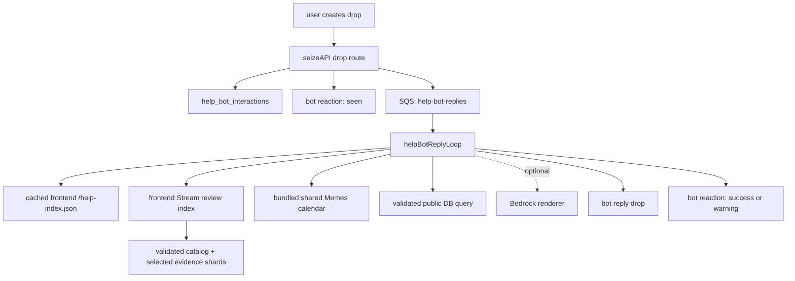
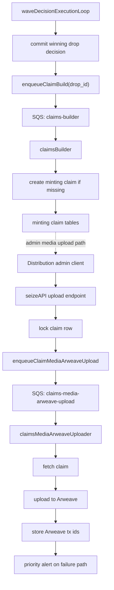

# Architecture Overview

This backend is a serverless, database-centered TypeScript system for 6529.io.
The main runtime pieces are:

- A single public API Lambda (`seizeAPI`) running Express.
- Many independently deployed background Lambdas for chain ingestion, derived data, media processing, notifications, and operations.
- MySQL as the source of truth.
- Redis as shared cache, rate-limit, dedupe, and short-lived coordination storage.

Legacy all-wave eligibility cache misses use a per-profile Redis lease so API
instances share one computation. Followers wait for a version-validated result
or a new lease, with a 12-second request budget. Owner-checked Lua publication
and a per-profile invalidation marker prevent stale owners from publishing
after lease replacement or explicit invalidation. See
[eligible-groups-coordination.md](eligible-groups-coordination.md).

- SQS and EventBridge as the async execution fabric.
- S3, CloudFront, Arweave, Ethereum/RPC providers, Firebase, Sentry, CloudWatch, Discord, and SNS around the core.

The six Sharp media packages also accept the exact direct-invocation payload
`{"operator_action":"verify_media_dependencies_v1"}` for release diagnostics.
This IAM-invoked path runs fixed synthetic codec operations in memory and
returns native versions before entering database, queue, storage or notification
processing. It adds no HTTP route; ordinary SQS, schedule and API Gateway
events keep their existing handlers. This lets operators verify each deployed
Lambda, including production-only media resizing and the three rememes
functions, without invoking whole production loops.
The resizer's HTTP API uses AWS_PROXY payload 1.0 without request templates;
request bodies remain inside the HTTP event envelope and cannot become this
top-level operator payload.

## Meme collaborator invitations

Artwork submissions retain one author, voting result and minting claim. The API
stores invitation status and the artwork/terms snapshot in `meme_collaborations`
and `meme_collaboration_invitations`, created by entity synchronization. Only
the invited identity can accept or decline; a proxy cannot consent. Acceptance
is final. Invitee acceptance saves a nullable, submission-specific artist credit name (up to 200 characters) separately from the profile handle. Old clients without the field save their handle; older accepted records retain handle fallback. Pending identities are visible only to the submitter and their own
invitee. Public drop V1/V2 mappings expose accepted collaborators and derive
artist/profile/Collab metadata from those records.

Native MAIN_STAGE decision transactions, including the transferred original Main Stage, lock the same
collaboration row used by acceptance, save the accepted artist roster, and close
pending invitations. Claims Builder consumes that saved roster for initial
claim credits; pending invitations do not delay minting. Admins can edit all final claim credits, traits
and artwork in Craft. The Arweave API and uploader use the saved claim with
normal metadata/media validation, without consulting invitations or comparing
it with the collaboration snapshot. Admin edits do not change invitation status
or accepted-submission profile attribution. Existing submissions without a
managed record remain compatible.

Invitation, acceptance and author-cancellation notifications use the existing identity-notification
and push pipelines with cause `MEME_COLLABORATION`. New generated endpoints are
`GET /drops/{drop_id}/collaborations`,
`POST /drops/{drop_id}/collaborations` (submitter-only additions on active
designated Memes Main Stage entries, including transferred original submissions), and
`POST /drops/{drop_id}/collaborations/{invitation_id}/response`; both use the
existing wave visibility checks. Accepted identities participate in Main Stage
profile artwork queries, without changing submission ownership or allowances.
No new Lambda, queue, environment variable, or on-chain contract is introduced.

After legacy runtime retirement, invitation eligibility and collaborator profile
submissions/wins use native Main Stage membership rather than physical drop types
or retired winner tables. Original submission routes pass their native owner to
the invitation writer so consent uses that competition's terms. The retained
wave GET compatibility projection supplies terms for older callers without an
explicit competition ID. The retired wave decision service is not restored;
`waveDecisionExecutionLoop` freezes credits through its native decision path.

## Oracle TDH API and retired Prenode registry

The existing `api` service retains Oracle TDH totals, thresholds, percentile,
cutoff, address breakdowns, season aggregations and NFT reads under `/oracle`.
`POST /oracle/register-prenode` and `GET /oracle/prenodes` return uncached
`410 Gone` responses with a 6529 Desktop deprecation notice. These terminal
routes do not access the registry or geolocation service. The historical
Prenode entity/table remains intact; no schema sync, migration or data deletion
is needed. `/oracle/docs` continues to describe the preserved TDH API.
Only `api` needs redeployment for this retirement.

## Active TDH voting discovery

`GET /v2/waves/active-votes` is an optional-auth read in the existing API Lambda.
It lists RANK/APPROVE waves using TDH, TDH_PLUS_XTDH or CARD_SET_TDH. Shared
read-context group eligibility and wave/parent visibility apply before count and
pagination; DMs and children of DM parents are excluded, even when readable.
The immutable original-primary compatibility projection supplies voting windows,
next decision state and APPROVE winner limits from native competition data. Results sort by the
nearest voting end or next decision, with open-ended votes last. This endpoint
does not assert that the current viewer can vote, and does not filter by joined,
pinned or recommendation status.

The permanent endpoint reads explicit native-backed wave/decision compatibility
views without a new cache or worker. New sibling competitions remain outside
this old wave-shaped contract; v3 resources provide competition-scoped discovery.

## Joined wave snapshot pagination

`GET /v2/waves/joined` is an authenticated, non-proxy read in `seizeAPI`.
It freezes the ordered IDs of joined, readable non-DM root waves, including
parents of followed subwaves, in a profile-bound Redis snapshot for 15 minutes.
Continuation cursors carry the snapshot ID, scan position and fixed page size.
Each page rechecks current membership and wave/group visibility, advances past
removed entries, and returns current overview data in the original ID order.
Missing metric rows do not remove a membership. New memberships appear on a new
snapshot. Snapshot creation verifies cache persistence; unavailable storage
returns 503, and an expired/unavailable continuation returns 410 for a coherent
client restart. Existing `/v2/waves` page-number contracts remain unchanged.
Snapshots have a 50,000-root capacity guard (about 2 MB of UUIDs per value);
larger lists return 503 without publishing a partial list or cursor. The normal
API rate-limiting middleware runs before the root router (`app.ts`), including
this route; the fixed TTL bounds refresh storage lifetime. Each page scans at
most 500 candidate IDs. A heavily pruned page can be empty with a non-null
continuation, keeping later memberships reachable without an excessive query loop.
Only positions strictly before the end of a snapshot are valid continuations.

The frontend opts into this endpoint only for Joined, retains loaded rows on
failure, and replaces all loaded pages together on refresh/expiry. It offers
Retry and Load more controls alongside automatic scrolling. This adds no table,
migration, queue or loop. Deploy `api` before the frontend in each environment.

## Wave eligibility

The maintained direct eligibility implementation serves profile-to-groups reads;
its Redis result cache, per-profile coordination, primary freshness checks,
invalidation and catalogue performance diagnostics remain in use. Explicit-ID
checks evaluate current rules directly. Set-based SQL serves group member lists,
previews, containment and online recipients under the same eligibility spec.

The materialisation experiment has been retired: application producers no longer
write source bookkeeping, the API has no materialised or shadow reader, and the
dedicated dispatcher, worker, backfill and fixture code is removed. Existing
membership entity metadata and obsolete additive schema scopes are removed.
Manual full sync uses only current entities and does not drop unregistered tables.
The shared group-search index remains. Monitoring no longer inventories the two
retired services. [The combined retirement runbook](membership-retirement.md)
requires explicit stack deletion and an operator-only staging table cleanup after
backups and prerequisite verification; ordinary deployment never runs that DDL.
Historical migrations and private per-environment recovery evidence are retained.

Shared SQL execution budgets remain in `src/db/`: acquisition, statements and
transaction finalization share a deadline, expired physical connections are
destroyed, and stale contexts cannot reuse a released connection. The reusable
primary transaction context and its regression tests are retained there.

## Proposal card media

Authenticated `POST /drop-media/proposal-frame` builds a bounded, fixed HTML
document around the submitter's uploaded image/video or recognized decentralized
artwork. Tracked image uploads must have completed sanitization. The endpoint
uses the existing upload profile authentication and API rate limiter, accepts
no client-authored HTML, and never fetches the source. Its versioned template
embeds the original media URL, with interactive HTML confined to a sandboxed
iframe, and publishes only `index.html` through the existing IPFS directory
uploader. The returned `text/html` URL follows existing decentralized HTML drop
validation and mint animation handling; the frontend retains a separate
`additional_media.preview_image` for static previews. Submitter-provided
`proposal_frame` editing metadata is excluded from public NFT traits and is
never used to authorize publishing or select mint media. Deploy `claimsBuilder`
(which excludes that metadata from traits) and `api` before the frontend consumer.
No new service, database schema, or migration is required.

Decentralized artwork remains untrusted: accepting a reference does not verify
ownership, MIME, or content safety. The declared MIME selects a rendering element,
not a trust level. An image/video response cannot execute as a document through
those elements, and HTML always uses `sandbox="allow-scripts"` without same-origin,
popup, download, or top-navigation permissions. This preserves the existing
interactive-art submission model without fetching arbitrary source content on
the server. The template applies attribute escaping before every media branch;
its separate URL guard also protects local previews, which do not use this API.

## Profile collecting and marketplace operations

The API owns `/collect/*` and `/market/*`. Collecting derives versioned catalogs
and set requirements for The Memes, Gradients and Pebbles, using the profile's
confirmed consolidated wallets. Existing Pebbles trait rankings use that same
profile scope. TDH projections reuse the production calculation kernel and
first verify parity with the official snapshot.

Meme Lab card trading resolves minted artwork from the existing `nfts_meme_lab`
index only when `/collect/assets?family=memelab`, an exact ownership analysis,
or a marketplace request explicitly names that collection. Exact analyses opt
into its indexed holdings across the same confirmed profile wallets. The known
Meme Lab contract is ERC1155 for discovery, exact-order resolution, single-order
preparation and atomic purchases, including verified criteria-offer acceptance.
This request-local extension never changes the shared planner catalog, set
goals, TDH eligibility or ranking families. API asset families include Meme Lab;
planning family schemas remain explicitly The Memes, Gradients and Pebbles.
It adds no tables or indexer dependencies; only the API service needs deployment.

Authenticated `POST /collect/tdh-target-plans` estimates a purchase subtotal for
a profile's total boosted TDH at a 1/30/90/365-day deadline, or an explicit
increase over its future no-purchase baseline. Its selected recipient must be a
confirmed wallet of that profile. It verifies official snapshot parity and
reuses one canonical projector for complete candidate portfolios, including
nonlinear set-completion bundles. Search is bounded to 128 replays, 10 million
modeled replay-work units and a 20-second request window; inventory validation
and hypothetical per-edition work are charged before each replay. It preserves
exact captured listing identities, fee-divisible steps, remaining quantities and
the atomic checkout's supported order shapes. Results distinguish best found,
no purchase needed and an unresolved target gap; captured index coverage never
claims complete live market coverage or a global minimum. Purchase subtotals
include signed fees, while gas and total funding remain unquoted until batch
review. Analysis adds no operation row, cache, table, migration, economic action
or loop dependency. Deploy `api`, then its frontend consumer. The frontend Help
Bot corpus must describe this new screen in the coupled frontend release.

Memes and Meme Lab extended data preserve `edition_size_cleaned` as supply
excluding burns and the configured Museum wallet. The new
`edition_size_ex_research` and `edition_size_ex_museum_and_research` fields
exclude burns plus, respectively, the configured Research wallet or the union
of the Museum and Research wallets. Research means `RESEARCH_6529_ADDRESS`,
not inferred identity consolidations; `research_holdings` reports that wallet's
balance. Supply ranks are ascending competition ranks, so equal supplies share
a rank (1, 1, 3). Other rank semantics are unchanged. New nullable columns and
API fields remain unavailable until the next extended-data refresh, while -1
continues to mean excluded from the ranking universe. These changes use the
shared Memes/Meme Lab pipeline and do not add Gradient or NextGen supply fields.
Deploy `dbMigrationsLoop` for entity synchronisation, then `nftsLoop` to populate
the fields, then `api` and its frontend consumer.

Authenticated `POST /collect/tdh-daily-plans` solves a desired acquisition base
TDH/day rate or an ETH purchase budget against the same signed listing capture.
It uses integer rates and costs, exact available quantity steps and fees, with
bounded alternative greedy portfolios. It excludes profile sellers and never
combines potentially overlapping orders from one maker for the same artwork.
The base-rate objective is separate from personalized effects: the selected
whole basket is replayed through the canonical calculator at the assumed
acquisition time to report ongoing boosted rates and the distinct revaluation
of existing TDH. Rates describe complete held days, not the next UTC snapshot
delta; a newly acquired lot starts with zero accrued days. An external recipient
can receive the artwork but adds no TDH to the requesting profile. Results keep
partial market coverage, best-found search, unspent budget and unknown gas
explicit. This endpoint does not create orders or write to the database and
does not replace the future-total target endpoint. Deploy `api` before its
frontend consumer; the coupled frontend release owns the Help Bot description.

Anonymous `GET /collect/tdh-listings` compares supported ETH asks across the
completed market-depth collection index. It reuses the marketplace adapter to
validate stored signed order identities, exact fill quantities and fees, and
applies observed cancellations and fills before ranking. Comparison uses exact
wei against the indexed base accrual rate rounded to production hundredths,
without inheriting seller holding time or applying profile multipliers. Reads
are bounded across collection partitions; freshness and index coverage remain
explicit. A short-lived cache contains only public discovery DTOs. An expiring
Redis refresh lease limits concurrent cold-cache work across API instances;
only its current owner can publish a result. Cursors
bind the ranked content, catalog and collection. Checkout still obtains a fresh
executable quote. This read-only endpoint adds no table or loop dependency and
requires only the API deployment, followed by its frontend consumer.

Private `POST /collect/offer-analyses` prices explicitly selected exact NFTs
with manual pins or transparent WETH formulas. It reuses bounded indexed books
and lifecycle observations; references remain explicitly unverified for live
funding and fulfillment. One payer funding snapshot and primary tracked
liabilities bound recommendations, while existing single-offer preparation
still performs fresh review and reserves actual exposure. The conservative
goal policy never signs, spends, or implies atomic group offers. It adds no
table or loop dependency. See [per-NFT offer analysis](../specs/collect-offer-analysis.md).

Collecting request budgets use a monotonic clock, with 20 seconds shared across
reads and parsing. The optional set-plan seed and TDH browse parser each receive
at most eight seconds within that budget. Seed expiry discards partial results
and preserves time for scanner-row persistence; browse expiry marks retained
results incomplete or returns a retryable refresh response when empty. Checks
inside synchronous order loops bound CPU work, while read wait bounds prevent
late responses from starting subsequent parsing. They do not claim to cancel
an already-issued database request. Market quote expiry still uses wall time.

The marketplace adapter obtains unsigned OpenSea Seaport actions server-side.
Closed schemas, a protocol/spender registry, independent action decoding and
chain simulation bind the exact artwork, quantity, wallet, recipient, fees and
economic limits. The client independently validates before asking its wallet
to sign or send. Purchase fulfillment delivers directly to a reviewed profile
or third-party recipient. The backend never holds user signing keys.

Browser preflights allow the required `Idempotency-Key` header only on
`POST /market/operations`, `POST /collect/rules` and
`POST /collect/rules/{id}/prepare`. These routes retain the public API's
non-credentialed CORS policy; their bearer authentication, mandatory
idempotency keys and financial validation remain enforced on actual requests.
Artwork documentation and credentialed session routes retain their separate
origin policies. This CORS repair requires only the `api` deployment.

Public `GET /market/orders/{order_hash}` resolves an exact supported Seaport
listing or offer outside the limited best-order discovery results. Required
asset, side and protocol parameters bind the requested identity. The API checks
signed terms, a fresh mainnet snapshot, maker counter and remaining fill fraction
under one request budget, returning the existing sanitized trade-order DTO.
It does not expose signatures, reserve inventory or create an operation;
authenticated preparation still revalidates financial execution. This additive
API boundary requires only the `api` deployment and no database migration.

`market_operations` and `market_operation_events` persist idempotent operations
and state transitions. A per-wallet/currency lock serializes potential offer
exposure before signable terms are revealed. `market_reviewed_transactions`
retains immutable execution payloads so an earlier reviewed transaction can be
recovered after refresh. A unique transaction-hash binding prevents duplicate
settlement attribution. Receipt reconciliation verifies canonical blocks,
Seaport events and NFT transfers; potential exposure persists until verified
fill, cancellation or safe-chain expiry.

Before the client opens a transaction prompt, a durable send attempt binds the
reviewed payload and operation revision. An unresolved attempt blocks another
send for that operation across browsers and devices. Hash recovery validates
the original approval or fulfillment; only a positively identified pre-broadcast
rejection can release an attempt without a verified transaction outcome.

Atomic Collect purchases use a separate `BUY_BATCH` request and response while
preserving the existing single-artwork contract. Each selected seller order has
an exact quantity, native-ETH cost and recipient allocations. The API builds a
Seaport 1.6 `matchAdvancedOrders` transaction with an unsigned payer mirror;
every selected order must fill or the transaction reverts. No router deployment,
new approval, automatic substitution or automatic splitting is involved.
Profile membership labels collecting and recipient scope; the directly
authenticated EOA pays, and profile or third-party wallets receive the NFTs.

`GET /market/batch-capabilities` reports bounds of 128 seller orders, 256
recipient allocations and 1 MiB of calldata. These bound parser, provider and
validator work rather than spend or editions. Preparation uses at most eight
concurrent selected-order tasks and a 20-second deadline. Complete simulation,
balance and padded gas checks must pass before review and before opening the
durable send attempt, including the current block limit and mainnet's
[EIP-7825 transaction gas limit](https://eips.ethereum.org/EIPS/eip-7825).
Exceeding a bound requires the user to reduce the selection explicitly.

`POST /market/operations/{id}/preflight` is a read-only, authenticated
`BUY_BATCH` check. Its small body binds the existing review revision and exact
transaction digest; the server loads and independently validates stored Seaport
orders, allocations and calldata. It sends only that transaction to the configured
Ethereum RPC provider, pinning both `eth_call` and raw `eth_estimateGas` to one fresh
block and rechecking the block hash. Ownership, current profile membership,
expiry, revision and recovery fences are checked again before returning. No
operation, journal, send attempt, gas cap or expiry is changed. A 12-second
abortable deadline, one concurrent check per actor, 12 checks per actor per
minute and a two-second per-operation cooldown bound work through fail-closed
Redis leases. This avoids sending large batch RPC bodies through the browser's
read provider; independent frontend validation and send-arming resimulation
remain mandatory. Only the API service must deploy before its frontend consumer.

Restricted ERC1155 seller orders currently support original and filled quantity
one. Open partial orders support multiple editions and recipients only when
every individual NFT/payment amount has an exact fill fraction. Discovery
publishes `purchase_quantity`, `quantity_step` and `available_quantity` so the
UI can distinguish an executable unit quote from a required whole lot. Batch
receipt reconciliation additionally requires every seller event, the exact
buyer mirror, complete `OrdersMatched` membership and every recipient transfer.
Uncertain evidence retains the recovery fence. Batch state and immutable mirror
terms use the existing JSON operation journal; there is no schema change.
History includes batches only with `include_batches=true`, and saved rules
continue to support single purchases only. This addition requires the API to
deploy before the dependent frontend; no indexing or migration loop changes.
Opt-in history omits batch calldata, send-attempt payloads and seller components
and bounds page bytes; clients follow its cursor and fetch the operation by ID
for complete review or recovery evidence.

`collect_plans` stores incremental listing scans with renewable leases and
profile/catalog invalidation. It distinguishes a completed asset scan from
incomplete market coverage. Plan responses optionally include `available_result`,
an uncapped comparison over the same captured candidates and evaluation instant,
alongside the result constrained by an explicitly echoed `budget_wei`. Without
a cap the same result is reused; otherwise one additional search is bounded to
20,000 states. Both use the same observed unit prices and estimated gas, make no
additional market reads and preserve incomplete coverage. Neither authorizes
spending or claims a global minimum. This additive response requires the API
before its frontend consumer, without database or loop changes.
`collect_rules` and `collect_rule_operations` store
fixed targets, review limits, one outstanding operation and monotonic verified
acquisitions. Rules only prepare transactions for owner approval. Their limits
are not a smart-contract-enforced mandate or authority to broadcast unattended.

Deploy the additive entity changes through `dbMigrationsLoop` before the API,
then deploy the dependent frontend. The exported TDH helper does not change the
scheduled TDH calculation and does not require a TDH loop deployment.
`MARKETPLACE_TRADING_ENABLED=false` stops new trade preparation/publication;
inspection, transaction reconciliation and direct cancellation remain available.
Action availability follows
[`handleGetCollectCapabilities`](../src/api-serverless/src/collect/collect.handlers.ts):

- `TdhScenario` is always enabled.
- `Cancel` requires `ETHEREUM_RPC_URL`, independently of the trading flag or
  `OPENSEA_API_KEY`.
- Other actions require both `ETHEREUM_RPC_URL` and `OPENSEA_API_KEY`, with
  `MARKETPLACE_TRADING_ENABLED` either unset (defaults to `true`) or exactly `true`.
- `RuleExecution` is always disabled; rules only prepare purchases for review.

Keep operation history and exposure tables when disabling or rolling back trading.

## High-Level Diagram

This is the compact map. Lambda boxes are intentionally just service names; trigger type is shown by the surrounding group or the queue/topic feeding the Lambda. The tables below carry the longer descriptions so the diagram stays readable.

```mermaid
%%{init: {"flowchart": {"nodeSpacing": 24, "rankSpacing": 58, "curve": "basis"}} }%%
flowchart TD
  Client["Client / web app"] --> APIGW["API Gateway<br/>HTTP + WebSocket"]
  APIGW --> SeizeAPI["seizeAPI"]

  SeizeAPI --> Auth["auth, routes,<br/>WebSockets, OpenAPI"]
  SeizeAPI --> ReadPool["API read pool"]
  SeizeAPI --> WritePool["API write pool"]
  ReadPool --> MySQL["MySQL / RDS"]
  WritePool --> MySQL
  SeizeAPI --> Redis["Redis"]
  SeizeAPI --> S3["public S3 media bucket"]
  SeizeAPI --> DropMediaIngestS3["private drop media ingest S3 bucket"]
  SeizeAPI --> MediaResolver["Decentralized media resolver<br/>native URI + gateway URL mapping"]
  SeizeAPI --> AiRpc["AI / RPC / webhooks"]

  subgraph Scheduled["Scheduled Lambdas (EventBridge)"]
    direction TB
    EventBridge["EventBridge schedules"] --> NftsLoop["nftsLoop"]
    NftsLoop ~~~ TransactionsLoop["transactionsLoop"]
    TransactionsLoop ~~~ NftOwnersLoop["nftOwnersLoop"]
    NftOwnersLoop ~~~ NftHistoryLoop["nftHistoryLoop"]
    NftHistoryLoop ~~~ DelegationsLoop["delegationsLoop"]
    DelegationsLoop ~~~ NextgenContractLoop["nextgenContractLoop"]
    NextgenContractLoop ~~~ NextgenMetadataLoop["nextgenMetadataLoop"]
    NextgenMetadataLoop ~~~ ExternalSnapshotLoop["externalCollectionSnapshottingLoop"]
    ExternalSnapshotLoop ~~~ ExternalLiveTailLoop["externalCollectionLiveTailingLoop"]
    ExternalLiveTailLoop ~~~ TransactionsProcessingLoop["transactionsProcessingLoop"]
    TransactionsProcessingLoop ~~~ TdhLoop["tdhLoop"]
    TdhLoop ~~~ TdhHistoryLoop["tdhHistoryLoop"]
    TdhHistoryLoop ~~~ OwnersBalancesLoop["ownersBalancesLoop"]
    OwnersBalancesLoop ~~~ AggregatedActivityLoop["aggregatedActivityLoop"]
    AggregatedActivityLoop ~~~ MarketStatsLoop["marketStatsLoop"]
    MarketStatsLoop ~~~ MarketDepthStreamLoop["marketDepthStreamLoop"]
    MarketDepthStreamLoop ~~~ RateEventProcessingLoop["rateEventProcessingLoop"]
    RateEventProcessingLoop ~~~ WaveDecisionExecutionLoop["waveDecisionExecutionLoop"]
    WaveDecisionExecutionLoop ~~~ WaveLeaderboardSnapshotterLoop["waveLeaderboardSnapshotterLoop"]
    WaveLeaderboardSnapshotterLoop ~~~ WaveDropMetricsRefreshLoop["waveDropMetricsRefreshLoop"]
    WaveDropMetricsRefreshLoop ~~~ WaveScoreRefreshLoop["waveScoreRefreshLoop"]
    WaveScoreRefreshLoop ~~~ XTdhGrantsReviewerLoop["xTdhGrantsReviewerLoop"]
    XTdhGrantsReviewerLoop ~~~ SubscriptionsDaily["subscriptionsDaily"]
    SubscriptionsDaily ~~~ SubscriptionCoverageReconciliationLoop["subscriptionCoverageReconciliationLoop (subscriptionsDaily stack)"]
    SubscriptionCoverageReconciliationLoop ~~~ SubscriptionsTopUpLoop["subscriptionsTopUpLoop"]
    SubscriptionsTopUpLoop ~~~ DiscoverEnsLoop["discoverEnsLoop"]
    DiscoverEnsLoop ~~~ RefreshEnsLoop["refreshEnsLoop"]
    RefreshEnsLoop ~~~ EthPriceLoop["ethPriceLoop"]
    EthPriceLoop ~~~ MintAnnouncementsLoop["mintAnnouncementsLoop"]
    MintAnnouncementsLoop ~~~ ArtCurationNftWatchLoop["artCurationNftWatchLoop"]
    ArtCurationNftWatchLoop ~~~ RememesLoop["rememesLoop"]
    RememesLoop ~~~ RoyaltiesLoop["royaltiesLoop"]
    RoyaltiesLoop ~~~ DbDumpsDaily["dbDumpsDaily"]
    DbDumpsDaily ~~~ NextgenMediaUploader["nextgenMediaUploader"]
    NextgenMediaUploader ~~~ NextgenMediaImageResolutions["nextgenMediaImageResolutions"]
  end

  subgraph Queues["Queue and topic triggered Lambdas"]
    direction TB
    WaveDecisionExecutionLoop --> ClaimsBuilderQueue["SQS: claims-builder"] --> ClaimsBuilder["claimsBuilder"]
    SeizeAPI --> ClaimsMediaQueue["SQS: claims-media-arweave-upload"] --> ClaimsMediaArweaveUploader["claimsMediaArweaveUploader"]
    NftsLoop --> S3UploaderQueue["SQS: s3-uploader-jobs"] --> S3Uploader["s3Uploader"]
    SeizeAPI --> AttachOrchestrationQueue["SQS: attachments-orchestration"] --> AttachmentsOrchestrator["attachmentsOrchestrator"]
    AttachmentsOrchestrator --> AttachProcessingQueue["SQS: attachments-processing"] --> AttachmentsProcessor["attachmentsProcessor"]
    SeizeAPI --> DropMediaSanitizerQueue["SQS: drop-media-sanitizer"] --> DropMediaSanitizer["dropMediaSanitizer"]
    SeizeAPI --> NftLinkRefreshQueue["SQS: nft-link-refreshes"] --> NftLinkRefresherLoop["nftLinkRefresherLoop"]
    NftLinkRefresherLoop --> NftLinkPreviewQueue["SQS: nft-link-media-previews"] --> NftLinkMediaPreviewLoop["nftLinkMediaPreviewLoop"]
    SeizeAPI --> PushQueue["SQS: firebase-push-notifications"] --> PushNotificationsHandler["pushNotificationsHandler"]
    SeizeAPI --> HelpBotQueue["SQS: help-bot-replies"] --> HelpBotReplyLoop["helpBotReplyLoop"]
    SeizeAPI --> HelpBotDailyCreditsQueue["SQS: help-bot-daily-activity-credits.fifo"] --> HelpBotDailyActivityCreditLoop["helpBotDailyActivityCreditLoop"]
    EventBridge --> HelpBotDailyCreditsQueue
    SeizeAPI --> ReleaseNotesQueue["SQS: release-note-generation"] --> ReleaseNotesGenerationLoop["releaseNotesGenerationLoop"]
    SeizeAPI --> WaveDropMetricsDirtyQueue["SQS: wave-drop-metrics-refresh-dirty.fifo"] --> WaveDropMetricsRefreshLoop
    SeizeAPI --> WaveScoreDirtyQueue["SQS: wave-score-refresh-dirty.fifo"] --> WaveScoreRefreshLoop
    TdhLoop --> TdhDoneTopic["SNS: tdh-calculation-done.fifo"]
    TdhDoneTopic --> XTdhQueue["SQS: xtdh-start.fifo"] --> XTdhLoop["xTdhLoop"]
    DelegationsLoop -->|partial TDH persisted| XTdhQueue
    XTdhLoop --> XTdhQueue
    TdhDoneTopic --> OverRatesQueue["SQS: over-rates-revocation-start.fifo"] --> OverRatesRevocationLoop["overRatesRevocationLoop"]
    TdhDoneTopic --> WaveScoreRefreshQueue["SQS: wave-score-refresh-start.fifo"] --> WaveScoreRefreshLoop["waveScoreRefreshLoop"]
  end

  subgraph RequestEventManual["Request, event, edge, SNS, and manual Lambdas"]
    direction TB
    CloudFront["CloudFront"] --> MediaResizerLoop["mediaResizerLoop"]
    CloudFront --> NextgenMediaProxyInterceptor["nextgenMediaProxyInterceptor"]
    S3 --> DropsVideoCreatedRule["S3 Object Created: drops/"] --> DropVideoConversionInvokerLoop["dropVideoConversionInvokerLoop"]
    S3 --> AttachmentObjectCreatedRule["S3 Object Created: attachments"] --> AttachmentsOrchestrator
    Operator["operator / deploy workflow"] --> DbMigrationsLoop["dbMigrationsLoop"]
    Operator --> CustomReplayLoop["customReplayLoop"]
    Operator --> PopulateHistoricConsolidatedTdh["populateHistoricConsolidatedTdh"]
    Operator --> TeamLoop["teamLoop"]
    CloudwatchTopic["SNS: cloudwatch-alarms"] --> AlarmEmail["confirmed email subscribers"]
    CloudWatch["CloudWatch alarm state changes"] --> MonitorBus["independent monitoring EventBridge bus"]
  end

  BackgroundWorkers["background Lambda runtime"] --> LambdaRuntime["doInDbContext runtime"]
  DropVideoConversionInvokerLoop --> EnvOnlyRuntime["environment-only runtime"]
  LambdaRuntime --> MySQL
  LambdaRuntime --> Redis
  LambdaRuntime --> Ops["Sentry / structured CloudWatch errors"]
  Ops --> MonitorBus
  EnvOnlyRuntime --> Ops

  S3Uploader --> S3
  AttachmentsProcessor --> S3
  DropMediaSanitizer --> DropMediaIngestS3
  DropMediaSanitizer --> S3
  NftLinkMediaPreviewLoop --> S3
  ClaimsMediaArweaveUploader --> Arweave["Arweave"]
  PushNotificationsHandler --> Firebase["Firebase"]
  PushNotificationsHandler -->|recipient-scoped notification invalidation| APIGW
  DropVideoConversionInvokerLoop --> MediaConvert["MediaConvert"]
```

## Lambda Inventory

### Scheduled Lambdas (EventBridge)

`newsletterLoop` is production-only and runs directly from EventBridge at 00:00 UTC.
It reads the previous UTC day of anonymous public wave activity from MySQL,
including public reply/quote context, Main Stage winners, and indexed Meme and Meme Lab mints.
Bedrock (`global.openai.gpt-6-astra` by default) composes a short newsletter;
the configured wallet signs into the existing API to publish one formatted drop.
Shared `prod/lambdas` secrets configure the destination, wallet, and signing key;
any missing value makes the run a successful no-op. Scheduled retries recognize
publication metadata on the primary DB, while manual `{}` invocations always
produce a fresh rolling-24-hour edition. Reserved concurrency is one. Deploy only
`newsletterLoop`, then refresh production operational monitoring to add its
allowlist, log subscription, and platform alarms; there is no schema, API, or
frontend dependency. Code passes
through `1a-staging` without deploying this service there. See
[public-wave newsletter operations](public-wave-newsletter.md).

| Lambda                                   | Purpose                                                                                                                                                             |
| ---------------------------------------- | ------------------------------------------------------------------------------------------------------------------------------------------------------------------- |
| `nftsLoop`                               | Discover, refresh, and audit NFTs.                                                                                                                                  |
| `transactionsLoop`                       | Index MEMES, Gradients, and Meme Lab transfers.                                                                                                                     |
| `nftOwnersLoop`                          | Maintain current owner balance snapshots.                                                                                                                           |
| `nftHistoryLoop`                         | Maintain ownership history.                                                                                                                                         |
| `delegationsLoop`                        | Sync delegation.cash and consolidation data.                                                                                                                        |
| `nextgenContractLoop`                    | Index NextGen contract events.                                                                                                                                      |
| `nextgenMetadataLoop`                    | Refresh NextGen metadata.                                                                                                                                           |
| `externalCollectionSnapshottingLoop`     | Snapshot external collection ownership.                                                                                                                             |
| `externalCollectionLiveTailingLoop`      | Live-tail external collection transfers.                                                                                                                            |
| `transactionsProcessingLoop`             | Normalize raw transactions into processed state.                                                                                                                    |
| `tdhLoop`                                | Calculate TDH and publish TDH completion.                                                                                                                           |
| `tdhHistoryLoop`                         | Write historical TDH snapshots.                                                                                                                                     |
| `ownersBalancesLoop`                     | Project owner balance aggregates.                                                                                                                                   |
| `aggregatedActivityLoop`                 | Calculate activity aggregates.                                                                                                                                      |
| `marketStatsLoop`                        | Aggregate market stats and archive full OpenSea order books for MEMES, Lab, Gradients, and each NextGen project.                                                    |
| `marketDepthStreamLoop`                  | Capture OpenSea order lifecycle events with overlapping scheduled subscriptions and idempotent persistence.                                                         |
| `rateEventProcessingLoop`                | Process DB-backed rating events.                                                                                                                                    |
| `waveDecisionExecutionLoop`              | Execute wave decisions and enqueue claim builds.                                                                                                                    |
| `waveLeaderboardSnapshotterLoop`         | Snapshot wave leaderboards.                                                                                                                                         |
| `waveDropMetricsRefreshLoop`             | Scheduled fallback that drains dirty drop metric refresh requests.                                                                                                  |
| `waveScoreRefreshLoop`                   | Scheduled fallback that drains dirty Wave Score refresh requests.                                                                                                   |
| `xTdhGrantsReviewerLoop`                 | Review xTDH grants.                                                                                                                                                 |
| `subscriptionsDaily`                     | Process daily subscription work and own the shared Serverless deployment stack for subscription reconciliation.                                                     |
| `subscriptionCoverageReconciliationLoop` | Reconcile projected subscription coverage from durable dirty keys every minute and run an hourly full sweep as a separate Lambda in the `subscriptionsDaily` stack. |
| `subscriptionsTopUpLoop`                 | Process subscription top-ups.                                                                                                                                       |
| `discoverEnsLoop`                        | Discover ENS names.                                                                                                                                                 |
| `refreshEnsLoop`                         | Refresh known ENS names.                                                                                                                                            |
| `ethPriceLoop`                           | Collect Coinbase ETH/USD every five minutes; repair missing history and dependent USD values.                                                                       |
| `mintAnnouncementsLoop`                  | Publish mint announcements.                                                                                                                                         |
| `artCurationNftWatchLoop`                | Watch curated NFT state.                                                                                                                                            |
| `rememesLoop`                            | Refresh rememes S3 files and metadata.                                                                                                                              |
| `royaltiesLoop`                          | Refresh royalty state.                                                                                                                                              |
| `dbDumpsDaily`                           | Create daily database dumps.                                                                                                                                        |
| `nextgenMediaUploader`                   | Upload NextGen media.                                                                                                                                               |
| `nextgenMediaImageResolutions`           | Generate NextGen image resolutions.                                                                                                                                 |

`transactionsLoop` receipt verification fails closed and raises per-function
error alarms. See the [transactions ingestion runbook](transactions-loop-ingestion-runbook.md)
for alert triage and recovery.

`ethPriceLoop` uses public Coinbase Exchange ticker/candle endpoints and repairs
missing price intervals together with transaction and Memes mint USD totals.
Transaction writers and mint initialization coordinate with recovery through
existing database transactions. Reset progress and expiring retries for omitted
Coinbase candles use existing Redis. Live prices commit before recovery, which
starts with at most one-hour batches and stops for the invocation on a database
failure. Repair updates indexed transaction date intervals using persisted prices
and selects affected mint tokens from those intervals. Work timeouts persist a
smaller batch window, while sustained fast successful batches gradually grow it.
Coverage is five-minute from January 1, 2026 onward and daily before that
boundary back to October 1, 2021. Any existing sample covers its older UTC day;
only absent days are filled, preserving existing rows. Reset uses the same split.
Provider pages feed continuous small database transactions until gaps
are drained or the Lambda's fifteen-minute deadline reserve is reached. Live
quotes refresh between batches during extended runs; the five-minute trigger is
not an execution deadline. Price gaps remain discoverable from `eth_price`
without schema changes. See
[ETH price recovery](eth-price-recovery.md) for timestamp semantics, bounded work,
reset behavior, and the required writer-before-collector deployment order.

### Triggered Lambdas

| Lambda                           | Trigger                                                                                                                             | Purpose                                                                                                                     |
| -------------------------------- | ----------------------------------------------------------------------------------------------------------------------------------- | --------------------------------------------------------------------------------------------------------------------------- |
| `api` / `seizeAPI`               | API Gateway HTTP/WebSocket                                                                                                          | Public REST API and WebSocket boundary.                                                                                     |
| `claimsBuilder`                  | SQS `claims-builder`                                                                                                                | Build minting claims from winning drops.                                                                                    |
| `claimsMediaArweaveUploader`     | SQS `claims-media-arweave-upload`                                                                                                   | Upload claim media and metadata to Arweave.                                                                                 |
| `s3Uploader`                     | SQS `s3-uploader-jobs`                                                                                                              | Mirror, compress, and upload NFT media.                                                                                     |
| `attachmentsOrchestrator`        | SQS `attachments-orchestration` and S3 object-created event                                                                         | Find uploaded attachment objects, retry, and enqueue processing.                                                            |
| `attachmentsProcessor`           | SQS `attachments-processing`                                                                                                        | Scan/process attachments.                                                                                                   |
| `dropMediaSanitizer`             | SQS `drop-media-sanitizer`                                                                                                          | Strip metadata from private-ingest drop/wave image uploads and publish sanitized originals.                                 |
| `nftLinkRefresherLoop`           | SQS `nft-link-refreshes`                                                                                                            | Resolve external NFT links.                                                                                                 |
| `nftLinkMediaPreviewLoop`        | SQS `nft-link-media-previews`                                                                                                       | Generate media previews for NFT links.                                                                                      |
| `pushNotificationsHandler`       | SQS `firebase-push-notifications`                                                                                                   | Deliver Firebase pushes and recipient-scoped WebSocket notification invalidations after notification rows are durable.      |
| `helpBotReplyLoop`               | SQS `help-bot-replies`                                                                                                              | Answer `@help6529` interactions and direct follow-ups to bot replies.                                                       |
| `helpBotDailyActivityCreditLoop` | SQS `help-bot-daily-activity-credits.fifo` with EventBridge wakeup fallback                                                         | Grant idempotent once-per-UTC-day activity credits from durable post-drop requests.                                         |
| `releaseNotesGenerationLoop`     | SQS `release-note-generation`                                                                                                       | Publish production Backend, Frontend, and Desktop release notes as `ci6529`.                                                |
| `waveDropMetricsRefreshLoop`     | SQS `wave-drop-metrics-refresh-dirty.fifo`; EventBridge fallback                                                                    | Repair materialized wave/dropper drop counts and latest-drop timestamps after drop deletes.                                 |
| `xTdhLoop`                       | SNS `tdh-calculation-done.fifo` or a direct post-persistence partial-TDH enqueue via SQS `xtdh-start.fifo`; self-queued stats phase | Recalculate the xTDH universe after TDH finishes, then rebuild and publish xTDH stats in a follow-up queue message.         |
| `overRatesRevocationLoop`        | SNS `tdh-calculation-done.fifo` via SQS `over-rates-revocation-start.fifo`                                                          | Revoke over-rates after TDH changes.                                                                                        |
| `waveScoreRefreshLoop`           | SNS `tdh-calculation-done.fifo` via SQS `wave-score-refresh-start.fifo`; SQS `wave-score-refresh-dirty.fifo`; EventBridge fallback  | Refresh materialized wave REP and Wave Score discovery fields after TDH changes or wave/drop/rating/subscription mutations. |
| `mediaResizerLoop`               | CloudFront/request path                                                                                                             | Resize images on demand.                                                                                                    |
| `nextgenMediaProxyInterceptor`   | Lambda@Edge / CloudFront request                                                                                                    | Provide NextGen metadata fallback.                                                                                          |
| `dropVideoConversionInvokerLoop` | S3 object-created event for `drops/`                                                                                                | Invoke MediaConvert for uploaded drop videos.                                                                               |

### Manual Or One-Off Lambdas

| Lambda                            | Purpose                                                           |
| --------------------------------- | ----------------------------------------------------------------- |
| `dbMigrationsLoop`                | TypeORM entity synchronization, usually run from deploy workflow. |
| `customReplayLoop`                | Controlled replay job.                                            |
| `populateHistoricConsolidatedTdh` | Historic consolidated TDH backfill.                               |
| `teamLoop`                        | Team CSV and Arweave upload.                                      |

## Runtime Shape

The API Lambda is the public synchronous boundary. It initializes local config or AWS secrets, opens MySQL read/write pools, initializes Redis, configures Passport JWT authentication, registers all routers, and then serves HTTP through `serverless-http`. The same handler also branches on API Gateway WebSocket route keys for `$connect`, `$disconnect`, and `$default` messages.

The API's Redis client is fail-fast: initialization waits a bounded time for the first connection, commands are rejected instead of queued while the client reconnects, and request-path cache reads/writes and rate-limit checks fail open within a short per-command budget, so per-client rate limits are not enforced while Redis is unreachable. Initialization failures are not cached; the next request in the same warm container retries setup, while route wiring runs at most once. Loops keep the default queue-until-reconnected Redis client.

Background Lambdas that read or write application state use a shared `doInDbContext` wrapper. That wrapper prepares environment/secrets, initializes TypeORM-backed DB access, initializes Redis, runs the job, then disconnects. The `dropVideoConversionInvokerLoop` is intentionally environment-only: it loads config/secrets, filters the S3 object key, and invokes MediaConvert without opening MySQL or Redis connections.

MySQL is the integration contract between nearly all modules. API routes, scheduled pollers, queue workers, and derived-data loops all read and write shared tables. Redis is secondary and mostly disposable: API request cache, rate limiting, webhook dedupe, locks, and selected feature caches can fail open or be repopulated from MySQL.

### Session refresh recovery

`POST /api/auth/session-refresh` uses a separate Redis rate-limit namespace.
Its defaults are 90 requests per second for bursts and 30 requests per second
across a 10-second window, configured by `API_RATE_LIMIT_REFRESH_BURST`,
`API_RATE_LIMIT_REFRESH_SUSTAINED_RPS`, and
`API_RATE_LIMIT_REFRESH_SUSTAINED_WINDOW_SECONDS`. The network identity remains
the rate-limit key; client-supplied addresses do not create new allowances.
Credentialed auth responses preserve their allowed origin on 429 and expose
`Retry-After` for browser recovery.

Native/desktop refresh accepts an optional UUID `refresh_request_id`. Clients
persist it with the old credential before sending a refresh, then reuse the
pair after an interrupted response. The API derives the successor with a
server-keyed HMAC and atomically rotates the existing stored hash. A duplicate
can recover only that immediate successor while the session remains active;
it does not rotate again or extend expiry. A different request ID, another
client type/address, revocation, expiry, or a later rotation prevents recovery.
Legacy clients without the request ID retain only a 30-second race-recovery
window. No raw token or request ID is stored server-side and no schema changes
are needed. Deploy `api` before the frontend, whose native request body adds
this optional field. Existing frontend clients remain compatible with the new
API. Once new clients are deployed, retain this API contract during rollback.
Keep `AUTH_SESSION_HASH_SECRET` (or its existing JWT-secret fallback) stable
through rollout and rollback: both stored session hashes and recovery derivation
depend on it. Rotating that secret invalidates existing session proofs; it is
not part of this release. Recovery deliberately stops at the rotated session's
expiry and never extends it. The legacy 30-second allowance starts at the
successful rotation's `last_used_at`; repeated recovery does not reset it.

## Main Data Flows

1. Client requests enter through API Gateway and land in `seizeAPI`.
2. The API validates input, authenticates JWT or anonymous context, reads/writes MySQL, uses Redis for cache/rate limiting, and sometimes publishes SQS work.
3. Scheduled ingestion Lambdas poll Ethereum/RPC/Alchemy, normalize chain state, and write canonical rows into MySQL. Ordinary mainnet reads use `ETHEREUM_RPC_URL`, independently of Alchemy NFT REST and indexed transfers. [Ethereum RPC provider portability](ethereum-rpc-provider-portability.md) records the explicit tracing and bulk-indexer exceptions and rollout requirements. NextGen's `addRandomizer` history entries optionally enrich the contract address with a name from the public Sourcify V2 API on the configured NextGen chain. The lookup needs no API key, has a five-second timeout, and falls back to the address on unavailable or malformed responses; enrichment failures do not stop indexing.
4. Derived-data Lambdas read canonical tables and write projections such as TDH, owner balances, aggregated activity, wave decisions, leaderboards, metrics, and reputation aggregates.
5. SQS workers handle slow or retryable side effects through named queues: claim building, claim media Arweave uploads, S3 media mirroring, attachment orchestration/processing, NFT link resolution/previews, xTDH recalculation, Wave Score dirty refreshes, and notification delivery through Firebase plus recipient-scoped WebSocket invalidations.

6. S3 and CloudFront serve media. All new drop/wave image multipart uploads use private ingest and the image worker, regardless of `DROP_MEDIA_SANITIZE_IMAGES`. The worker checks the container format against the declared MIME type before publication and rejects HEIC/HEIF with export guidance. The API captures the privacy choice in private multipart object metadata: false preserves original image bytes and true retains metadata stripping; missing policy preserves sanitization for older queued uploads. Published validation and privacy markers are separate. Single-PUT image preparation and legacy untracked public image multipart sessions cannot bypass the gate. Transport length failures remain operational. See [image-upload-format-validation.md](image-upload-format-validation.md) for scope, limits and compatibility. AVIF still-image drop uploads always convert through this worker, even when `DROP_MEDIA_SANITIZE_IMAGES=false`. The worker applies orientation, strips metadata, and publishes WebP at quality 95 for compatibility with older supported mobile viewers. Multipart completion/status responses return the published `mime_type`, and drop references validate that type. AVIF admission rejects sequences, invalid content, images over 64 million pixels, dimensions over 16,383 pixels, and file-type headers over 4 KiB before publication. These AVIF decoder and header bounds remain separate from the PNG and other codec preview policies below. Image processing uses a shared 256 MiB source ceiling; other media retains the existing 500 MB transport limit. Verify shared ingest storage, then deploy the sanitizer in each environment before enabling AVIF through the API and frontend. API deployment verifies the ingest bucket and sanitizer queue exist.

   Other drop and wave image uploads can first land in a private ingest bucket, then `dropMediaSanitizer` strips metadata and publishes the sanitized full-size original to the public bucket before CloudFront/resizer paths serve it. Other specialized media paths include on-demand resizing, video conversion, and NextGen metadata placeholder interception. Drop-video multipart completion can accept a bounded device-generated JPEG, validate and strip its metadata, and store it before completing the original video. Conversion always keeps the existing HLS/MP4 renditions and adds bounded first-frame/one-second JPEGs only if a validated device poster is unavailable. Chat prefers the device image, then the later backend image, falling back to the first for legacy or short clips, and displays it before Play without fetching video bytes. The worker reads and expands the existing MediaConvert template without modifying it; its deployment includes template-scoped read and device-poster access policies. The API execution role also needs narrow device-poster write and pending-upload read access. Existing uploads need a separate authorized replay. See [chat video previews](chat-video-previews.md) for storage and rollout details.
   The on-demand media resizer spools each S3 source into its own temporary file before metadata inspection and conversion. A shared 256 MiB source limit rejects oversized inputs with HTTP 422. PNG uses measured 100 MP/8-bit and 64 MP/16-bit admission, a 100,000-pixel input-side limit, and disposable Sharp child processes. PNG output is capped at 4096 pixels per side, two million pixels and 10 MiB encoded; ordinary fit/orientation behavior is preserved and oversized results are fitted inside a bounded box. Each PNG child has a 256 MiB JS heap, a 30-second lifetime and a sampled 1 GiB combined parent/child RSS watchdog. These are guards with headroom under the 2 GiB Lambda allocation, not hard native allocation guarantees. Corrupt/over-limit input is permanent; timeout, allocation/worker, monitor and I/O failures remain operational. Source and output files live until upload completes and are removed after success or failure. Non-PNG codecs retain the conservative 512 MiB decoded-work estimate; animated GIF admission counts every frame. Baseline 8-bit JPEG admission accounts conservatively for the decoder shrink used by the requested resize; progressive JPEGs and other codecs retain the full-input estimate. When a GIF animation exceeds the budget, only its first frame is resized if that frame independently fits. Otherwise it remains HTTP 422. Originals are unchanged, and already-posted images can receive previews on demand without re-uploading. Resize, rotation and output contracts are preserved for ordinary accepted inputs. Multipart upload concurrency is one, and the temporary directory is removed after completion or failure. These admission limits reduce resource risk; they do not guarantee a maximum native allocation for every codec. The specific HEIF missing-compression-plugin error is returned as `422 UNSUPPORTED_CODEC`, regardless of the filename or MIME label. One operational report is claimed per original S3 key and source version (VersionId, or ETag for unversioned objects), across resize variants and Lambda instances, using an empty conditional-write marker under `_resize-rejections/v1/` in the existing source bucket. Later requests retain warning logs and the controlled response; replacing the source enables a new report. Marker failures remain operational errors. Detected HEIF/HEVC inputs now use an isolated, pinned WebAssembly HEVC decoder and explicit JPEG output, independent of the source suffix/MIME label. The child has separate source/pixel, JS heap, WASM memory and time budgets. Confirmed permanent HEVC decoder rejections use `_resize-rejections/v2/` markers keyed by source revision and decoder policy: later requests still spool/inspect the source but skip pixel decoding and return HTTP 422. Source or decoder-policy changes permit another attempt. S3/worker/timeout/allocation failures remain operational; the generic Sharp HEIF `(7.0)` error is not broadly suppressed. A source length mismatch remains operational before decoding or caching. See [media-resizer-unsupported-input.md](media-resizer-unsupported-input.md) for decoder, alert and recovery limits.
   Drop/wave image finalization now generates and verifies both legacy `AUTOx450` and `AUTOx1080` previews using the same admission and PNG renderer as on-demand resizing before it can mark media ready. All image source handling and optional privacy stripping are file-based; full source and encoded-original buffers are not retained in the parent. PNG original stripping uses an isolated child; other original re-encodes must fit the conservative full-decode budget without preview shrink or discarded GIF frames. The original and both derivatives must be stored before the ready transition and ingest deletion. Derivative storage failures remain retryable and never imply ready. A retry regenerates the previews and overwrites the same keys; a ready-message redelivery only retries best-effort private-source deletion. Other formats retain their format/privacy transformations and existing animated-GIF first-frame fallback. The sanitizer reserves 1 GiB ephemeral storage for source, sanitized original and derivatives. Existing ready uploads are not requeued; the corrected on-demand PNG path can populate their missing derivatives without changing source/drop URLs.
   The animation-preview implementation (requires `mediaResizerLoop` deployment) handles versioned GIF requests (`AUTOx450_gifv2`, and the other existing sizes with `_gifv2` appended) with animation-preserving processing instead of the legacy first-frame fallback. The suffix is removed before checking the existing size whitelist and resolving the original key, but retained in the S3 derivative key. AUTO sizes use a sequential native decode and one resize directly to bounded output dimensions; fixed crop sizes retain individually coalesced frames and a repeated-scan guard. The bounded RGBA strip is spooled before encoding; output resolution can shrink further to bound the complete animation. The deployment catalog sets this worker to 2048 MiB for CPU headroom while retaining its processing deadline and source/output safety limits. Frame timing, loop count, and transparency are retained. Admission limits cover source bytes, per-frame pixels, frame count, repeated decoder work, retained output, and processing time. An eligible original that already fits an AUTO dimension is copied unchanged. See [GIF animation previews](gif-animation-previews.md) for limits, rollout, and compatibility. Originals and legacy derivative keys are not overwritten.
   Public media objects carry `Cache-Control` set when they are written, because the media CloudFront distribution also serves the desktop app's update feeds (`6529-core-app/`, `6529-staging-core-app/`), which must not be cached long. Keys that never receive different bytes use `public, max-age=31536000, immutable`: drop, wave and distribution uploads (random id per upload; multipart uploads set it at creation), sanitized drop media, profile pictures, rememe images (write-once), device video posters and NFT link previews. Per-token NFT originals and derivatives under `images/` and `videos/` are rewritten in place when a token's media source changes, so they use `public, max-age=86400`, as do on-demand resizer outputs and upload-generated previews at those same derivative keys. Single-PUT presigned uploads and MediaConvert renditions do not set it yet.

7. Operational signals flow to Sentry, CloudWatch alarms, Discord, and SNS.

### Ordinary Ethereum RPC boundary

The shared provider in `src/ethereum-rpc/` reads the server-only
`ETHEREUM_RPC_URL` for mainnet after environment/secrets loading. Sepolia and
Goerli compatibility paths require their own explicit URLs; missing configuration
or unsupported chains never fall back to mainnet or an Alchemy key-derived URL.
Ethers retains chain-ID verification. Standard compatibility reads keep their
retry and response-shape contracts; CMS ENS owns a separate bounded transport
using the same URL, and marketplace batch preflight retains its abortable raw
transport with an explicit mainnet chain check.

`src/alchemy-sdk.ts` now owns only NFT REST and `alchemy_getAssetTransfers`.
Mixed indexing jobs use both clients without changing pagination or checkpoints.
Non-standard `trace_block` has a separate provider policy: Alchemy normally,
or the existing mainnet 6529 trace endpoint with Alchemy fallback where selected.
Selecting traces does not select the transaction/receipt provider. ENS no longer
has a hidden 6529 endpoint fallback; its Universal Resolver fallback uses the
configured ordinary provider and explicitly enables CCIP-Read for off-chain
ENS records. Fallback errors retain their null result and emit only allowlisted
categories, separating resolver reverts from transport and off-chain failures
without logging raw errors or revert arguments.

`NFT_INDEXER_RPC` remains the independently configured external-indexing/NFT-link
capacity boundary. The unused API-root AWS Managed Blockchain `/rpc` proxy,
including `/rpc/test` and all sub-paths, has been removed; requests fall through
to the normal 404 response. The separate `rpc1.6529.io` API Gateway and `rpcProxy`
Lambda continue to serve app-wallet fallback and mainnet tracing traffic to the
same managed Ethereum node. Neither that Lambda nor the node is removed by this
API retirement. The bulk indexer and tracing exceptions are not controlled by
`ETHEREUM_RPC_URL`.
See the [implementation and rollout record](ethereum-rpc-provider-portability.md)
and the historical [foundation record](../ops/workstreams/ethereum-rpc-foundation/README.md).
Configuration is loaded once by warm services; redeploy/restart affected services
when changing endpoints. No database, API schema, queue or deployment-workflow
change is needed.

### NFT link preview job recovery

The resolver records `media_preview_queued_at` using database time when it claims
an enqueue. During a normal metadata refresh, an unchanged-source `PENDING` or
`PROCESSING` preview can be requeued only when both its enqueue timestamp and
worker lease are older than ten minutes. This exceeds the preview worker's
120-second runtime and the queue's 300-second visibility timeout. A row lock
serializes concurrent producers, and the new enqueue timestamp prevents repeated
refreshes from flooding the queue. Legacy pending rows with no enqueue timestamp
are eligible when they have no recent worker lease. Recovery preserves cached
preview URLs and invalidates the old completion lease; READY records and the
existing oversized-media cooldown are unchanged. This is demand-driven recovery,
not a scheduled sweep: the NFT must be refreshed again.

The nullable column is added by the existing entity-sync deployment. Deploy
`dbMigrationsLoop` before `nftLinkRefresherLoop`, `api` (`seizeAPI`), and
`nftLinkMediaPreviewLoop`. Old producers remain compatible but do not recover
stalled jobs until updated. No API schema or alert configuration changes.

### NFT link media preview size failures

Preview images and unrecognized content retain their configured byte cap (30 MB
by default; production currently uses 200 MB). Byte-identified video has a separate
250 MB default cap (`NFT_LINK_MEDIA_PREVIEW_VIDEO_MAX_BYTES`); MIME headers alone
do not grant that allowance. Videos are copied, not transcoded. A typed header or streamed
byte overrun records FAILED and preserves cached preview URLs. A repeated
resolution of the same original source under the same observed image/video policy waits one
hour before enqueueing another preview attempt. The first failure is still
reported; ordinary decoder, HTTP and network failures retain their existing
retry behavior. Expiry permits the next demand-driven attempt, not scheduled
work. Source changes, a newly observed cap/policy version, malformed state and
successful generation reset eligibility. A smaller asset at an unchanged URL
can wait one hour plus the time until another resolution request.

The private preview error/state column holds bounded versioned oversize data,
or a UUID lease marker while PROCESSING. Public API and drop mappers exclude
this field. Every terminal worker update requires the exact marker, source
hash and PROCESSING status; READY clears the marker and failures replace it.
Worker lease and completion timestamps use the database clock. Active legacy
leases are respected; expired leases can be reacquired. Invalid timestamps
cannot impose an indefinite cooldown, and locks more than one lock TTL into the
future are treated as invalid. The owning AbortController disposes rejected response
bodies and requests. The existing HTTP timeout covers headers; a separate
`NFT_LINK_MEDIA_PREVIEW_DOWNLOAD_TIMEOUT_MS` deadline covers DNS, all redirects
and the full body, defaults to 90 seconds, and cannot exceed 90 seconds.
Each download owns cancellable A/AAAA DNS queries (without OS hosts-file
lookup), checks both families for private addresses, and pins the selected IP.
The header byte limit is intentionally coarse because MIME types can mislabel
video; byte sniffing applies the image or video cap during streaming. This
reserves time within the 120-second preview worker for upload and persistence.
For animation/video cards with a distinct metadata image, the worker falls back
to that image when the preferred animation exceeds the byte limit, returns
HTTP 404/410, or is HTML. The fallback shares the original download deadline,
uses the image byte cap and the same URL/DNS/redirect guards, and must decode
successfully through the existing image renderer. Other HTTP errors and timeouts
remain failures. A successful fallback stores an image preview while preserving
the original animation metadata and source hash for lease fencing/cache reuse;
missing or failed fallbacks retain the existing failure/unsupported behavior.
A READY image fallback is reused under the original source hash; recovery of
the same animation URL does not automatically replace it with a video preview.
Oversize records include both limits so scheduling and processing share the same
policy; legacy records become eligible once under the new policy.

Secrets are loaded once per warm process. A cap change resets eligibility only
after each caller observes that configuration; deliberate changes must refresh
the affected preview worker and resolver/API producer processes. Old in-flight
workers do not enforce the new lease marker. A coordinated rollout must drain
the preview event source for the old worker's full 120-second timeout before
claiming universal completion fencing. The resolver/API inline fallback can
enqueue preview work, but only the preview worker downloads and renders it.
Old producers may still enqueue during mixed rollout, so cooldown acceptance
also requires the relevant producers to be current. No schema synchronization
or media deletion is needed, and rollback treats the private marker as ordinary
error text. None of these controls guarantees preview output for oversized
assets or identical fallback behavior across frontend views.

### NFT link refresh outcome monitoring

The SQS refresher opts into one metadata-only Embedded Metric Format record
(`6529.nft.refresh.v1`, namespace `6529/NftLinkRefresher`) after each successful
persistence. Retry attempts and lock/eligibility skips do not count as completed
refreshes. Dimensions are the fixed environment and provider; canonical-link
hashes are source-log evidence only. The API's synchronous resolver keeps its
existing notification policy, and refresh timing/cache semantics are unchanged.

Recognized required-page 404s, bounded HTTP timeouts, retryable HTTP statuses
and known network faults retain warning logs and outcome counters. Intermediate
retries do not notify. Unknown errors, access denial, noncanonical 404s,
persistence failures, preview/notification failures, and Lambda platform errors
retain operational notification paths. Cancellation caused by the refresher's
HTTP timeout is explicitly typed; arbitrary abort messages are not classified.

The source monitoring stack owns provider-level CloudWatch incidents: 5% failed
eligible outcomes with at least 20 samples in each of three consecutive
five-minute periods; and a 15-minute newly-unavailable surge with at least 20
completed outcomes and either five new failures comprising 10% of completions,
or five previously working links newly failing. A link contributes to the new
count only when its persisted failure episode starts; repeated 404s contribute
to unavailable counts only. Success resets the existing failure episode.
Both alarms require successful observations and at least 20 outcomes for
recovery as well as detection; missing or sub-gate traffic preserves state. These are initial operational thresholds,
not a product freshness SLO or proof that every affected link recovered.

Existing platform/OOM alarms remain. The NFT queue additionally alarms on a
30-minute oldest-message age in three of five minutes and on any visible dead
letter. The source stack owns the dedicated NFT outcome dashboard and must deploy before the worker.
See [monitoring policy and rollout](../ops/monitoring/README.md#nft-refresh-outcomes).

### NFT link refresh bounds

The `nft-link-refreshes` SQS event source caps concurrent invocations at the
worker's reserved concurrency (20), so polling does not exceed its execution
capacity. The source monitoring stack requires throttles in three of five
one-minute periods before raising the refresher throttle alarm; invocation
errors and OOMs still alarm immediately.

`nftLinkRefresherLoop` applies a 90-second resolution budget, reduced to leave
10 seconds before the Lambda deadline and processing-lock expiry. Its RPC
transport cancels connections and response bodies after five seconds; metadata
HTTP requests also observe the overall budget. Retries stop when the remaining
budget cannot cover their backoff and another RPC. Failed resolution preserves
cached metadata and releases the existing processing lock.

An exact HTTP 404 from a required Transient or Manifold canonical page ends
further attempts in that eligible run. The internal nullable
`nft_links.refresh_retry_state` JSON records a versioned, page-scoped delay:
5 minutes, then 15 minutes, then at most 60 minutes, with 0–10% negative jitter.
Both API enqueue paths and the worker's primary-row transaction enforce it.
This remains demand-driven: future reads or queued work can retry after the
delay; there is no periodic retry sweeper and no terminal invalid-NFT state.
Success clears the delay and retains the ordinary two-minute refresh interval.
Failure keeps cached metadata, media, price and last-success time. A processing
lock timestamp fences late writes after another worker takes ownership.

Only typed errors from the required canonical HTML fetch qualify. A Transient
HTTPS redirect from `transient.xyz` to `www.transient.xyz` also qualifies when
the path and query are identical and neither URL introduces credentials,
an explicit port or a fragment. Only a boolean identity result is retained;
the final redirect URL is not stored on the error. Optional title enrichment,
all other URL redirects, asset/metadata API 404s, 429s, 5xx responses and
contract reverts retain their existing retry policy. Retry
state is internal to persistence and is not added to the public NFT-link model.
Old writers invalidate stale retry state by advancing the attempt timestamp or
clearing the failure fields. Queued messages from older producers remain
subject to the upgraded worker gate.

Before deploying these callers, explicitly run `dbMigrationsLoop` with
`schema_scope=nft-link-page-retry`. This inspects the single NFT entity and
permits only `ALTER TABLE nft_links ADD refresh_retry_state json NULL`; it
rejects unrelated schema drift and skips full synchronization, migrations,
backfills and retention. Leave the nullable column in place during application
rollback. The resolver worker and API are primary callers; help-bot reply,
release-note generation and media-sanitizer broadcasts can also enqueue via
drop mapping. Updating an entity import alone does not require a fleet rollout.

The SuperRare adapter preserves the ERC721 `tokenURI` path. A contract revert
can fall back to `uri` only after positive ERC1155 interface detection; transport
failures and unsupported interfaces remain failures. ERC1155 `{id}` placeholders
in the metadata URI and consumed metadata strings use the standard 64-digit
lowercase hexadecimal token ID. Existing URI normalization and bounded HTTP
handling apply; this does not establish token existence or media availability.

The Manifold adapter requires selected-token and token-asset responses to match the requested
instance ID and rejects known ID mismatches on legacy responses too.
When present, it reads string metadata from `publicData.selectedToken`
or `publicData.tokenAsset` (the latter also supports animation metadata)
and normalizes supported decentralized media to HTTP(S) without credentials;
the existing preview download safety checks still apply. Complete title and media
avoid an unnecessary canonical-page OG fetch. Listing metadata does not prove an
active sale, so these cards use the unknown sale state and a view action. Legacy
claim and edition field extraction remains available when both token shapes are absent,
including older responses without a recognizable instance ID. A listingType-only
response keeps those legacy assets and uses an unknown market state with a view
action, without inferring a claim price.

After persistence, a worker-specific notifier reads active WebSocket recipients
once and sends the existing `MEDIA_LINK_UPDATED` payload with concurrency 10,
five-second request limits, and a 15-second broadcast deadline. Notification
failure cannot change a successful metadata refresh. The notification metadata
read is bounded to five seconds; both notification queries also use a three-second
database execution limit. Late read results cannot trigger delivery.
Cancelled preview-queue sends leave their source retryable, without overwriting
newer previews or active consumers. Expired or disconnected
clients are skipped; normal WebSocket lifecycle handling retains ownership of
stale-connection deletion. The API and other resolver callers retain their
existing policy. Request IDs, message IDs, and stage durations connect these
operations to CloudWatch invocation reports. Sentry's existing warning timer is
unchanged. No API, schema, queue, or frontend deployment dependency is added.

### NFT market depth and activity

`marketStatsLoop` legacy price pagination and market-depth REST requests share
the existing Redis OpenSea request quota, with local pacing when Redis is
unavailable. Successful price pages proceed as quota permits; retries and the
shared refresh deadline remain bounded, and incomplete scans never replace stored
prices.

`marketStatsLoop` publishes complete OpenSea order snapshots atomically with
current orders and a persistent queue for reconciling disappeared orders.
Publication uses a `READ COMMITTED` transaction, locks the collection state and
inserts its archive, then acquires the same exclusive row in
`market_depth_publication_locks` across all four collectors before replacing
current orders. The shared
transaction lock prevents reciprocal PRIMARY-index insertion deadlocks between
different collections and releases on commit or rollback. Fetching, normalization
and compression, partition locking and archive insertion remain outside the
shared lock. Each publication logs `lock_wait_ms`,
`lock_held_ms` (through transaction finalization), `insert_ms` (order mapping,
SQL construction and all insertion chunks), total time, row count and outcome;
failed phases retain their measured timing without logging order payloads.
Snapshot reads retain their existing transaction isolation so metadata and
orders come from one consistent view.
Existing price statistics run concurrently with an independent deadline; both
tasks finish before the database context closes. Collection books are attempted
before lifecycle maintenance, which prioritizes status reconciliation and
checkpoints bounded REST catch-up batches.
`marketDepthStreamLoop` records live order lifecycle events, while REST event
catch-up and per-order status checks recover supported missed observations.
Stream appends opt into the shared SQL execution budget, with a five-second
total deadline and one-second finalization reserve within the remaining run
budget. The SQL owner finalizes the transaction or disposes of its connection
before the stream retries or closes its database context. Pre-commit failures
can retry after cleanup; an unacknowledged COMMIT leaves the batch unconfirmed
and stops retries and final draining. Acknowledged commits remain confirmed
through connection cleanup failures. REST appends retain their existing session
and transaction behavior.
Seven `market_depth_*` tables coordinate publication and retain immutable
compressed archives, current orders, collection state, events, cursors and retry
work. All amounts and quantities
needed for normalization preserve exact integer strings.

The API exposes currency-specific quoted depth for an individual token and a
merged feed of canonical transactions and market actions. Quoted quantities can
share inventory or funding and are not a verified executable security budget.
The activity feed uses the read replica, including partition discovery and
history metadata. Token activity selects bounded token and collection-event
pages separately using the existing token/time index, then merges their IDs
before fetching public event fields. Order-book snapshots, critical partition
discovery and order-status validation continue to use the writer.
See the [market depth runbook](../ops/runbooks/market-depth.md) for interpretation,
provider limitations, deployment order and verification.

### Alchemy NFT metadata proxy

`GET /alchemy-proxy/contract` retains its existing address lookup: `address`
must be `0x` followed by 40 hexadecimal characters; missing or malformed input
returns HTTP 400. It uses V3 `getContractMetadata` and returns the provider
metadata with `_checksum`, or JSON `null` when the provider returns 404. The
route retains its five-minute request-cache middleware. FE uses this endpoint
as fallback for its address-only picker.

`POST /alchemy-proxy/contracts` accepts up to 50 Ethereum contract addresses
and deduplicates case variants before lookup. It returns `{ contracts: [...] }`
with checksummed addresses, chain, and provider metadata including `_checksum`.
Provider 404 produces null metadata; other failures remain per-contract errors
so successful entries are preserved. Lookups run at most ten at a time with
five-second timeouts and no retries. A 20-second lookup scheduling budget
reserves time for initialization and response handling within the API Lambda's
30-second timeout. Once another full lookup cannot fit, remaining entries
receive per-contract 504 errors while completed results are preserved.
Responses use `Cache-Control: no-store`.
The bounded lookup client reuses centralized Alchemy configuration and is
cached per shared client. Provider initialization failures are logged and
return HTTP 500 before individual lookups. Invalid provider payloads are
reported as per-contract lookup failures.
This completes the fallback used by the desktop xTDH Granted list without
requiring a desktop update. Its OpenAPI path overrides the `/api` server base
because the existing proxy router is mounted at the root.

Collection-name search is retired: `GET /alchemy-proxy/collections` returns
HTTP 410 with `Cache-Control: no-store` and the error message
`Collection name search is no longer available. Use a contract address.`
It makes no upstream or cache request, including for missing or empty queries.
The removed search wrapper has no remaining callers; ingestion, ownership
queries, and token metadata continue using their existing supported endpoints.

### Content moderation

See [Content moderation](./content-moderation.md) for the complete feature
policy, publication decision flow, API surface, posting-suspension lifecycle,
data ownership, retention, and rollout contract.

Drop text passes a permissive pre-publication gate for new posts and edits. It
checks profile suspension and narrow deterministic signals first; only
signaled, ambiguous text is sent to a dedicated Bedrock evaluator. Known
malicious destinations may be rejected directly, while evaluator errors and
uncertain classifications fail open. Drop attachment contents remain in the
existing asynchronous attachment safety pipeline rather than this text gate.

Authenticated non-proxy viewers can report drops, hide individual drops, and
block profiles through `/content-moderation`. Reports, private evidence
snapshots, and requested personal hide/block actions commit atomically before
the reported-content Bedrock assessment runs. Only a high-confidence urgent
recommendation can temporarily quarantine a drop; ordinary results remain in
the developer review queue. Authorized developers can restore,
quarantine, or remove drops and suspend or reinstate posting profiles.
Privileged access requires a directly authenticated, non-proxy 6529 identity
eligible for the saved 6529 Dev Team group
(`6529-dev-team-xuahLBqRGQr6yX9R5yna4V`). All moderation access and action paths
use the existing targeted eligibility rules without cross-request membership
or group-definition caches. The actor must match the authenticated identity.
Mention recipients and broader roles do not grant access. A missing group
denies access; failed lookups return HTTP 503 and a bounded operational diagnostic.
The prioritized queue uses opaque
stable cursors. There is no continuous review queue or hold-before-publish
state.

The developer [moderation review API](../ops/docs/developer/moderation-review.md)
captures REP, About, group-name, signaled pre-publication and reported-content
evaluations in `content_moderation_items` and `content_moderation_evaluations`.
It replaces moderation's Discord notifications with database evidence and
versioned, idempotent human actions. Existing stricter public-field prompts
remain separate from permissive wave-content prompts. Exact rejected content
can receive a seven-day single-use resubmission permit; approval never publishes
an archived draft. About and group-name suppression uses an exact-revision
presentation overlay while preserving source values. Routine successes expire
after 30 days, resolved evidence after 90 days, and compact history after one
year; unresolved evidence and active rules retain their required provenance.

Standalone moderation capture uses bounded five-second SQL units with at most
three total attempts; it retries only after acknowledged deadlock rollback.
Finalization and retention
lock the moderation item before evaluation/audit rows; retention discovers
candidates without locks and rechecks them under the item lock. Caller-owned
transactions retain their own retry/lifecycle authority. Private moderation SQL
callbacks bind the issuing invocation's logging and operational contexts so a
reused socket cannot attribute an error to an earlier request. See
[Moderation capture recovery](./moderation-capture-recovery.md) for the limits,
privacy contract, and rollout scope.

MySQL stores viewer blocks and hides, reports, global drop and profile states,
moderator roles, pre-publication decisions, and an append-only audit history.
Pre-publication decision records are retained for 30 days and pruned daily by
`dbMigrationsLoop` in bounded batches of 1,000 rows, capped at ten batches per
invocation; this exceeds the ten-minute duplicate-detection window.
Drop API mappers retain structural graph metadata but redact globally
unavailable content across V1, V2, light-drop, reply, quote, and WebSocket
surfaces. Notification writes, reads, badge counts, and push delivery suppress
blocked authors and globally unavailable drops. Global state takes precedence
over viewer block and hide state; authors retain access to their own globally
moderated content, while other clients may locally reveal personal tombstones
but never globally quarantined or moderator-removed content.

CI deploy and WEB E2E signals enter the API through the signed pipeline-alert
route. The API renders and posts the deploy drop, then retains successful WEB
deploy reply targets in Redis by deploy run ID. Terminal E2E signals carry those durable identities back to the API; only
an unambiguous match becomes a drop reply, while missing or inconsistent state
falls back to a standalone result. Workflows never own Seize drop IDs. See
[CI Pipeline Alerts](./ci-pipeline-alerts.md) for the request, formatting,
retention, rerun, and rollout contract.

Notification read/unread mutations also enqueue a `badge_refresh` job with the affected profile ID on the existing `firebase-push-notifications` queue. `pushNotificationsHandler` combines shared-device refreshes within each batch, discovers current iOS registrations, and computes aggregate unread counts from the primary database using the existing push settings, visibility and moderation filters. The API performs only the queue handoff, not device lookup, counting or Firebase delivery. Normal iOS alerts and badge-only refreshes share a per-device Redis lock covering count calculation and submission. Android delivery and installation logout use the same lock to fence removed recipients. Failed or invalid profile contributions never become partial badge totals. See [Mobile badge synchronization](./mobile-badge-sync.md) for the payload, failure handling and rollout boundaries.

The push worker's SQS event source is capped at 18 concurrent batches, below the Lambda's reserved concurrency of 20. This leaves two slots of headroom and keeps excess burst traffic queued instead of allowing the poller to exceed the function limit. The same cap applies in staging and production. Batch size remains 10; partial-batch retries, visibility timeout, dead-letter routing, and monitoring thresholds/frequency are unchanged. Queueing can increase during bursts, so queue-age and dead-letter alarms remain important. Deploy only `pushNotificationsHandler` to apply this event-source configuration.

Notification invalidation is emitted only after the push worker loads durable notification rows. It intentionally remains independent from mobile push registration, mute settings, and delivery success because those controls affect Firebase delivery only; the durable row remains visible through the authenticated REST feed. Duplicate SQS deliveries may repeat this idempotent invalidation without duplicating notification data.

WebSocket registration and re-authentication persist the identity, JWT expiry and notification grants atomically. Existing connection mutations lock the connection row before subscription rows; identity resync and deletion use the same order, and missing connections cannot gain grants. Repository-owned mutations use transaction-scoped `READ COMMITTED` to avoid shared subscription-gap locks when different sockets replace empty grants. Pooled session defaults, caller-owned isolation and sampled cleanup keep their existing policies. Only a transaction's owner retries confirmed deadlocks, with at most three whole attempts and bounded jitter; caller-owned transactions and ambiguous failures propagate. Socket acknowledgements follow persistence, and socket/provider operations remain outside the retried transaction. New connections, re-authentication, and identity resyncs each retain a one-percent chance of running bounded cleanup of expired and orphaned subscriptions after persistence. The repository identity update method remains the sole write path for `ws_connections.identity_id`.

If authentication or notification identity sync finds that the stored connection has disappeared, the API requests transport closure and then removes orphan subscription state before returning 410. This condition does not reject the credential and sends no authentication or subscription acknowledgement. Unexpected operation, close or cleanup failures remain 5xx, with fixed action/stage warning labels alongside the existing response error envelope. The mounted web application's health check can reconnect a disconnected socket using its current token; reconnect timing depends on client lifecycle and browser scheduling. The local WebSocket adapter follows the same closure path. This defensive recovery does not establish the cause of any historical connection loss.

Typing updates use the server-authenticated connection profile when resolving private visibility groups. The sender must appear in the current child/parent membership intersection for the active wave before a typing message is sent; recipients retain the same intersection. Successful typing is acknowledged with 200, expected access failures keep client-error status, and unexpected failures emit only bounded operation-stage and error labels.

Outbound WebSocket delivery uses one policy in `src/ws-delivery/`, shared by the API, background senders and the worker-specific NFT-link notifier. Final 429s retain a hashed connection identifier and bounded SDK metadata in warnings and low-cardinality EMF metrics; they do not emit per-send operational errors. Shared Redis cooldowns use exponential backoff with jitter and a short endpoint pause for broad throttling. Normal healthy sends remain concurrent. Atomic leases apply only to recovery probes. Each connection has one content-free pending refresh marker; user content and credentials are never queued. A revision prevents an in-flight recovery from acknowledging newer missed updates.

The scheduled `webSocketDeliveryLoop` drains due markers every minute, rechecks stored JWT expiry, and sends `RESYNC_REQUIRED`. It never replays competition outbox events, notifications or winner effects. Updated clients invalidate active HTTP queries after a staggered delay, including after reconnect and app/tab resume. Only an isolated persistently blocked listener that advertised `recovery_capability=resync_v1` may be closed, after observing healthy peers; confirmed transport closure precedes subscription deletion. Widespread failures inhibit that close policy. Existing 410 cleanup and error reporting for non-429 provider failures remain intact. Authentication and notification-identity acknowledgements have priority; legacy failures return an explicit failed outcome and never enqueue a substitute refresh marker.

Rolling fleet counters distinguish widespread throttling, a persistent outage even with a single listener, and an old retry backlog. The recovery worker emits the `6529/WebSocketDelivery` Degraded, WorkerHealthy and Pending metrics. CloudWatch alarms report sustained degradation, worker failure/missing heartbeat and repeated recovery-store failures, with explicit operational guidance in the isolated monitor. Application metrics retain SDK retries, 429s and cooldown suppressions because API Gateway metrics may omit 429s. Redis operations are bounded; unavailable recovery state fails open for direct sends, returns an explicit failed result when retry persistence is unknown, and retains independent monitoring. Retry state is versioned, endpoint-scoped and expires after two hours and five minutes without activity; deploying the worker before producers and the additive frontend consumer preserves a compatible rollout.

## API Boundary

The API is organized by domain routers under `src/api-serverless/src`. The OpenAPI file defines the public contract and generated models. Legacy routes are wired manually, while newer OpenAPI operations can opt into generated route wiring through `x-6529-router` and thin domain handlers.

`GET /tdh/rules` publishes current TDH boost definitions evaluated against the
latest completed snapshot's eligible Meme card range. The latest row in
`tdh_blocks` is the completion marker because consolidation persists its TDH
rows before publishing that block. The API combines the block timestamp with
Meme mint dates and current season definitions, then applies the calculator's
shared eligibility and boost helpers. Rule definitions are current server
configuration, not historical or versioned inputs persisted with the snapshot.
The public current-season rules and configured future schedule remain
independent of any collector identity.

Authenticated profiles prepare a chat-history purge through
`POST /waves/{id}/my-chat-history`, which freezes the author's latest CHAT serial number
in a signed token bound to the author and wave without deleting anything. Clients
retain the token before `DELETE /waves/{id}/my-chat-history?purge_token=...`, reuse
it across retries, and continue until `has_more` is false. Each transaction locks
the wave and at most 101 eligible CHAT rows, deletes at most 100 through set-based
SQL, and preserves the current pinned drop. An indexed serial range avoids
locking the complete history. Newly sent messages remain outside the cutoff.
Legacy DELETE without a token completes histories of at most 100 eligible drops
and rejects larger histories before mutation, preventing false partial success.
Proxies remain forbidden; former wave members can still remove their own chats.
The batch repository mirrors single-drop dependent-data cleanup, including poll
and voting children, tombstones, curation order compaction and empty token-watch
cancellation, and additionally removes boost/NFT-link associations. Metrics deltas,
latest timestamps, DM unread versions and dirty repair markers run once per batch;
post-commit refresh requests, unread-cache invalidation, and bounded batches of
existing DROP_DELETE notifications preserve current client behavior. No schema,
queue, worker or deployment-unit changes are required; deploy `api` before the
frontend continuation UI.
The range queries use the existing `idx_drop_wave_type_author` index declared
on `DropEntity` in `src/entities/IDrop.ts`; TypeORM schema synchronization already
owns this index. Wave and dropper metrics rows are initialized by
`applyInsertedDropMetricsDelta` in the drop-creation transaction, and this path
preserves the existing deletion-delta/full-resync invariant. Tokens are signed
but readable and contain only the caller's own scope. Clients treat them as
opaque handles. They deliberately have no expiry so a delayed retry retains its
original cutoff; authentication and author/wave binding remain required on every
request.

Waves are chat, visibility and administration hubs containing zero or more native
competitions under `/v3/waves`. Competition configuration and entry state own
submissions, eligibility, voting, weighted scores, decisions and winners. Current
navigation/settings/entries/voting/My Votes/leaderboards/winners/admin use the
competition resources for every competition. The scoped `entry-contexts` GET
batches up to 50 visible entries, current/at-decision vote summaries and their
awards; it resolves competition access once and applies content visibility to the
batch. Leaderboard, winners and entry-context responses accept `include=cards`
to return visible first-part content, complete metadata and native voting state
in the same response. This projection bypasses legacy full-wave voting reads;
summary refreshes reuse cached content, while opening a drop retains the full
drop reader. The option is additive, with no schema changes; deploy `api` before
the frontend that requests it.
TDH publication discovers native overvotes in one set-based query per locked
competition, using absolute active-entry spending and current TDH/xTDH or the
configured NFT set. WAVE credit compares the shared total; DROP credit compares
the largest individual allocation. Only over-limit voters enter the existing
credit-reduction/history/notification path, and the leaderboard is rebuilt once
after all reductions. Fully funded competitions do not reload vote history or
rewrite leaderboards. Discovery and mutations remain in the existing TDH
publication transaction, including delegation-driven partial recalculations and
post-TDH over-rate cleanup. Deploy the affected consumers sequentially:
`overRatesRevocationLoop`, `delegationsLoop`, then `tdhLoop`; their unchanged
xTDH dependencies are already compatible. No schema or frontend rollout is needed.

Winners paginate by win time, newest first; My Votes excludes completed winners
without deleting historical allocations. Personal votes sort by signed vote value
descending, vote update time ascending and drop ID ascending. Its optional
`include=cards` response reuses the authorized lightweight competition card reader;
deploy `api` before the frontend that requests this additive projection.
Personal-vote cursors describe a live list, not a snapshot. After a vote edit,
clients must refresh loaded pages from the first cursor before loading more,
because changing a value can move an entry across page boundaries. The frontend
invalidates the scoped My Votes query after each confirmed vote. The existing
competition/voter index restricts reads to that actor's allocations; an additional
sort index is deferred until query-plan evidence justifies a schema rollout.
Creating a hub always creates a
CHAT wave; competition creation is a separate native command. Historical RANK/APPROVE wire types are projected from native original-primary
configuration; shared wave storage no longer owns a competition type.

Shared CHAT participation and voting settings are live typed policies in
`waves.hub_participation_config` and `waves.hub_voting_config`. They preserve
independent nullable roles, credit settings, periods, signatures, required
content, terms, retained credit-NFT tuples and existing typed decision-strategy
metadata. Strategy metadata preserves current GETs and explicit clearing; it does
not enroll a competition or enable CHAT decision execution. Current hub creation,
editing and reading own these policies; `waves_archive` holds their snapshots.
Original competition configuration continues to own original competition GETs.
One-time policy preparation and all fourteen temporary capture triggers are
retired. Current nullable strategy members never reimport obsolete physical values.

Permanent unversioned/v2 wave/drop GETs use explicit native-backed compatibility
views. Their ownership is the immutable `legacy_wave_id=wave_id` original primary,
independent of default-competition selection. Sibling competitions do not appear
as old competitions; their shared content retains CHAT classifications in those
contracts. Views explicitly list public columns and never discover columns from
or union retired physical competition tables. Wave metadata remains shared:
primaries inherit it while `presentation_config` is null; native arrays override
it, including an explicit empty array. Weighted snapshot publication is distinct
from live standings and has its own native `published_at` marker.
Published historical snapshots without an entry remain in the existing native
leaderboard relation for permanent GET compatibility, including nullable hold
thresholds. They create no membership and cannot participate in native listings,
voting, ranking, decisions or claims.

Independent AGGREGATE and VOTER observations live in `competition_score_history`.
Retained source IDs/timestamps/values and inconsistent observations stay intact,
including observations without a current entry. A native mutation sequence orders
accepted votes across rolling versions without pairing streams by timestamp.
Weighted scoring consumes these native observations. Entry content revisions
retain complete score history and use existing native update events to delimit
the scoring revision. Current allocations, immutable decision voter snapshots,
and awards retain their existing separate native tables.

Vote Activity combines competition-scoped shared profile logs and native vote
history. Exact `<competition-id>:<sequence>` identities deduplicate before
pagination; equal values/timestamps never imply a duplicate. IDs, timestamps,
proxy attribution, reason JSON and independent shared profile history survive.
The public profile API omits the internal competition scope column. Native
outbox receipts preserve historical starts/transitions; a configuration update
first enqueues due transitions for its prior version before replacing it.

`waveLeaderboardSnapshotterLoop` and `waveDecisionExecutionLoop` remain existing
Lambda units and execute only native work. Per-competition execution mode,
lifecycle, locks, command idempotency receipts, signature nonces, outbox leases,
per-effect receipts and delivery receipts remain authoritative. Draft/DISABLED
competitions cannot vote or execute. MAIN_STAGE/CURATION/QUORUM capabilities,
claim mapping, curation transfers, nomination cleanup, REP/TDH revocation,
profile consolidation, winner notifications and newsletter readers use native
configuration/entries/snapshots. Capability restrictions remain independent of
storage history or sharing a special wave. Mixed chat handlers retain chat
posting/reactions/visibility/notifications.
Curation token watches register only explicit eligible CURATION entry content.
Pre-entry creation carries its verified competition permit; existing drops use
locked active membership. A shared hub or default selection grants no watch
behavior, and unresolved orphan drops remain inert. Independent transfers sharing
a timestamp retain distinct effects and rank-one winners under a nonunique rank
index; decision/entry identity remains unique.

Native command receipts include the effective actor and commit with domain writes,
nonce consumption and events. Publication and current eligibility are rechecked
under the competition lock. Shared-chat competition context selects scoped
credits/votes and never falls back to an old executor. Dedicated native content
remains immutable; imported submissions retain their allowed pre-winner edits,
content revisions and atomic vote resets. Deletion hides entries through existing
visibility/tombstone rules and does not replay accepted effects. Wave deletion
still rejects competition history and chat purge preserves submissions.

Original Settings applies the native rule policy under the owner lock before
saving. Credit rules freeze after any native voter history; permitted title and
presentation edits remain available through both command routes.

The original creation/write/read/execution/shadow flags, storage selector and
migration/reverse/reconciliation commands are removed. The inert
`competitionMigrationLoop` and its dedicated continuation policy, version,
invocation configuration, alarms and monitoring registrations are retired. Its
private recovery artifacts remain independently retained; the native decision
and leaderboard units remain deployed. `retained-producers.json` is empty.

`dbMigrationsLoop` has no old competition entities or transition scopes. Manual
`maintenance` installs the permanent native views without synchronizing entities;
scheduled maintenance performs no DDL. Explicit `full` first rejects remaining
retired columns, then synchronizes current entities and maintains native views.
Intentional physical deletion is an operator boundary with encrypted snapshot,
independent restore verification, exact schema/data manifest, old-invocation
drain, short metadata-lock waits and online-only DDL. It never occurs implicitly
through TypeORM. Repeated full maintenance must leave old objects absent.
The [cleanup procedure](competition-storage-cleanup.md) specifies the compatible
service order, recovery evidence and exact four deleted-wave orphan targets.
Native history, receipts, claims and shared archival/user history remain intact.

Default navigation evaluates only published native configuration with deterministic
active/upcoming/completed ordering, inclusive end boundaries and server refresh
times. It never repoints the old public primary mapping. CURATION retains price
ordering/bounds and capability-specific presentation on competition-scoped APIs.
The immutable Phase 0 GET fixtures and route/OpenAPI census remain enforced.
Disposable MySQL acceptance physically removes old tables/wave columns and checks
compatibility projections, native votes/history/activity and repeatable decisions.
Staging and production physical cleanup follow the separate reviewed manifest.
Media/CDN objects are outside this cleanup.

Important API responsibilities:

- Authentication and refresh-token flows. Legacy wallet auth keeps `/auth/nonce`,
  `/auth/login`, and `/auth/redeem-refresh-token`; wallet auth session v2 uses
  separate endpoints such as `/auth/session-nonce`,
  `/auth/session-login`, `/auth/session-refresh`, and `/auth/session-logout`.
  Web session-v2 challenges are canonical ERC-4361 SIWE messages whose scheme,
  domain, and URI are bound to the exact normalized first-party request
  `Origin`. They are carried in short-lived, server-signed object envelopes
  bound to the allowlisted request API host. Native and desktop session-v2
  challenges retain the existing structured-message format and are explicitly
  requested with `client_type=native` or `client_type=desktop`. Both formats
  complete all semantic and wallet-signature checks before a final atomic nonce
  consumption. The full auth contract is documented in
  [Wallet Authentication](auth/wallet-auth.md).
- Public read APIs for NFTs, TDH, waves, drops, profiles, community metrics,
  subscriptions, and notifications. Wallet distribution allocation reads
  combine Phase 0–2 distribution rows with Public subscription airdrops, while
  returning card-level publication state without exposing the full Public
  subscription list. They intentionally accept any wallet address without
  authentication because distribution plans are public and the home page must
  render before wallet authentication. Responses use a 60-second route cache
  to limit repeated database reads while keeping publication changes timely.
- Paginated group-member inspection uses `GET /community-members/top` for a
  saved group and supports parameterized handle or wallet search. Authenticated
  `POST /groups/preview-members` evaluates an unsaved group description through
  the same membership SQL without creating a group, identity group, or other
  persistent record. Draft identity-address and NFT-token criteria remain bind
  parameters, and results reflect the current indexed metrics and ownership
  state. The [eligibility specification](eligibility-spec.md) pins parity with
  direct evaluation, including explicit Level zero and identity-shaped empty
  member results. This changes no materialization runtime or API contract.
- Wave mention autocomplete under `/v2/waves/{waveId}/mention-search`, which
  derives visibility eligibility from a persisted wave, and the authenticated
  `/v2/waves/mention-search` draft endpoint, which applies the selected
  visibility group before the wave exists. Both perform indexed handle-prefix
  matching and return a minimal profile result ranked by level.
- Global REP category analytics under `/rep/categories/{category}`, backed by current non-zero REP rating rows for category overview, giver-recipient pairings, recipient rankings, and giver rankings.
- Public OG metadata inputs for profile, wave, and drop link previews under `/og-metadata`.
- Public profile-native CMS primary package lookup under
  `/profile-cms/{handle}/primary`, returning the published production-safe CMS
  V1 package envelope used by `/{handle}/index.html`; draft, failed, fixture,
  and missing primary packages return 404.
- Authenticated profile-native CMS publish hardening under `/profile-cms`,
  including EIP-712 publish intent verification, canonical IPFS/Arweave receipt
  checks, rollback/archive endpoints, and package export data for future
  standalone renderers and mirrors.
- Authenticated profile-native CMS wallet gallery snapshots under
  `/profile-cms/wallet-gallery/snapshot`, enabled by default with an explicit
  `FEATURE_PROFILE_CMS_WALLET_GALLERY=false` override, reading indexed NFT ownership
  and normalized media from MySQL for deterministic gallery generation.
- Profile-native CMS BYO-agent affordances under `/profile-cms/agent` and
  `/profile-cms/packages/{id}/agent`, including a public schema bundle,
  read-only source packets that separate facts, author copy, derived metadata,
  and validation diagnostics, and authenticated draft patch validation that
  dry-runs agent proposals without applying changes or bypassing publish
  signing/storage authority.
- Public decentralized media resolution under `/media/resolve`, which maps
  native `ipfs://`, `ipns://`, and `ar://` references plus recognized gateway
  URLs to canonical native URIs, `media.6529.io` resolver URLs, and explicit
  external fallback URLs. This v1 API does not proxy media bytes.
- Authenticated direct-message unread summary under `/dm-drops/unread`,
  retaining the lightweight `{ count }` contract for legacy clients, plus the
  authoritative per-conversation state under `/dm-drops/unread/snapshot` for
  clients that synchronize unread state through WebSockets.
- Authenticated social writes: drops, votes, reactions, curations, subscriptions, groups, proxies, profile CMS package drafts/publish actions, minting claims, and push settings.
- `@help6529` trigger detection after drop creation. The API writes a durable `help_bot_interactions` row, reacts with the bot's seen marker, and enqueues the reply worker when the `help6529` profile exists.
- Upload preparation and multipart completion for drop media, wave media, distribution photos, and attachments. All new drop/wave image multipart uploads complete into private ingest storage for mandatory format validation; metadata stripping remains a separately captured upload policy. They return `media_status=processing` and publish a `DROP_UPDATE` websocket event with reason `MEDIA_STATUS` after the sanitizer marks the media ready or failed. Participatory drops in the configured Main Stage wave accept managed-CDN GLB media and verify each stored S3 object's authoritative size is no more than 250 MB (250,000,000 bytes) before attachment.
- WebSocket connection registration and real-time wave-related messages.
- Operational endpoints such as health, docs, RPC/proxy routes, webhooks, and deploy-related routes.

Wave rows can be top-level waves or subwaves through the nullable `parent_wave_id` column. Top-level wave discovery endpoints exclude subwaves, while `/waves/{id}/subwaves` lists child wave overviews. Subwave read access also requires the parent wave to be visible, and deleting a parent wave cascades through the API service to delete its subwaves.

Wave overview `has_competition` is true for Rank or Approve wave types, or when the wave has any competition record, including drafts and completed competitions. Competition existence is fetched in one batch for the overview page and its visible parent waves.

Ordinary chat drop creates and edits do not initialize obsolete competition
storage. Edits lock existing native entry memberships; imported submissions and
permanent deletion retain the native ownership fence. No migration trigger or
legacy-to-native transfer participates in current writes.

Wave writes enforce that every active Drop, Vote, Chat, and Admin membership is
contained by the Wave View membership. The generated
`POST /wave-group-validation` boundary exposes the same privacy-preserving
preflight result to clients as failing scope names only. Dynamic group
membership is evaluated with one batched anti-join query, group-version swaps
are checked before replacing a Wave-referenced group, and runtime privilege
flags remain intersected with View eligibility if group criteria later drift.

The waves v2 read boundary keeps timeline, reply-thread, and curation feeds as separate contracts. `/v2/waves/{id}/drops` returns the wave timeline feed, `/v2/drops/{id}/replies` returns the reply thread for a root drop after resolving its owning visible wave, and `/v2/waves/{id}/curations/{curation_id}/drops` returns drops for one wave curation.

Quick Vote's legacy `GET /waves/{id}/undiscovered-drop` remains compatible,
while `GET /waves/{id}/undiscovered-drops` returns up to four ordered previews
with one pair of exact counts. Both use the original legacy competition's
active native entries and an indexed fallback for retained participatory drops
without a projected native status. Votes and skips remain scoped to the acting
profile; zero allocations are unrated, and either sign of nonzero allocation is
rated. A single aggregate computes total unrated and unskipped unrated counts.
Preview windows place newest unskipped drops before skipped drops ordered by
oldest skip time, then newest drop time and serial number. These native reads
bypass compatibility SQL rewriting; full drop mapping still uses the ordinary
visibility and voting projections. The frontend shares each completed window's
first preview and counts with its footer cache. This adds no schema or worker;
deploy only `api` before the dependent frontend in each environment.

Current vote-allocation summaries use separate card and detail read paths.
V2 rank-wave leaderboard responses can add an optional
`submission_context.voting.largest_vote` to visible active participatory
submissions. This is one voter's current signed allocation with the greatest
absolute size, not necessarily a positive vote. The mapper batches the
extrema lookup for the page and hydrates the selected voter identities;
unavailable highlights do not prevent reading the leaderboard.

`GET /v2/drops/{id}/vote-summary` returns an optional `vote_distribution` with
complete signed positive and negative totals and at most three individual
allocations per direction. It checks the existing wave-read eligibility and
drop moderation presentation before querying voter state. Missing or
inaccessible drops return 404; unsupported drops, content the viewer cannot
see, and drops without nonzero allocations omit the distribution. Both
summary paths are limited to `PARTICIPATORY` drops in `RANK` waves, excluding
winner snapshots. Ordinary single-drop GETs and voter-list endpoints remain
unchanged. These amounts are current allocations, not vote-edit deltas or
time-weighted scores; vote writes, ranking, and score calculations are
unchanged.

These read-only summaries query `drop_voter_states`; the schema already
defines a `(drop_id, votes, voter_id)` index. They add no tables, jobs, writes,
or backend cache. The detail response is bounded to six voter entries, but
exact totals still aggregate the drop's current nonzero allocations. Query-plan and
production-load performance have not been measured; bounded response size is
not a constant-cost query guarantee.

For the wave configured by `MAIN_STAGE_WAVE_ID`, v2 winning-drop responses can
also expose an optional Meme card ID through their submission context. The
public `/meme-cards/{id}/drop` lookup provides the reverse link. Both directions
are limited to configured Main Stage winner rows; unrelated waves and legacy
drop responses are unchanged.

The waves v2 boundary also exposes `/v2/official-waves`, backed by the `official_waves` selector table. It returns readable `ApiWaveOverview` rows for listed wave ids and skips stale entries whose wave row no longer exists.

Wave creators and wave admins can manage arbitrary wave metadata pairs through `/v2/waves/{id}/metadata`. Read access follows the same wave visibility rules as other wave v2 reads, while writes are restricted to the creator or members of the wave admin group. Metadata is stored in `waves_metadatas`, keyed by wave id and metadata key.

Wave creators and wave admins can attach one inline poll to a chat drop through the drop creation API. Poll definitions, options, and votes are stored in `drop_polls`, `drop_poll_options`, and `drop_poll_votes`; poll reads follow existing drop and wave visibility rules, include the authenticated profile's selected option numbers, and poll votes replace the acting profile's previous answers for that poll. A poll vote also creates the normal notification and Firebase push notification path for the drop author with the voter identity and selected option labels.

Wave poll listing is exposed through `/v2/waves/{id}/polls`, returning paginated `ApiDropV2` data for drops that have inline polls, ordered by drop `created_at` descending by default, with optional `sort=closing_time` and `state=OPEN|CLOSED` filtering.

## Database Boundary

There are two DB access modes:

- API mode uses mysql read/write pools. Simple SQL classification routes `INSERT`, `UPDATE`, `DELETE`, and `REPLACE` to the write pool; other queries default to the read pool unless forced.
- Loop mode uses TypeORM initialization and the shared `SqlExecutor` abstraction. Schema ownership is entities-first: add or update TypeORM entity classes, export them from `src/entities/entities.ts`, and let `dbMigrationsLoop` run entity synchronization. Do not create SQL migrations for schema changes unless explicitly requested; migrations are reserved for one-off data work or views.

The MySQL query options capture the legacy GET compatibility boolean conversion
mode when each statement is submitted. Compatibility views can expose boolean
columns as BIGINT, so their declared flags need explicit conversion. Field parsing
must not read request context from a reused socket: that socket can have been
opened by another request. Queries outside the compatibility scope retain numeric
BIGINT values, including when they reuse a socket opened inside that scope.

The core architectural choice is that MySQL is both the system of record and the internal integration layer. This keeps the system understandable, but it makes table contracts, migrations, backfills, indexes, and worker idempotency especially important.

The operational `wallet-transfer-analysis` CLI derives undeclared Memes wallet
relationship candidates from existing `transactions` rows without inference or
external chain requests. It maintains `wallet_transfer_pair_days`,
`wallet_transfer_wallet_days`, and `wallet_transfer_analysis_states`. Daily
directional counts and wallet denominators are partitioned by fixed 1,000-block
source buckets, replaced transactionally, and checkpointed. Bounded updates
reconcile the latest processed bucket and advance through new activity; explicit
bounded rebuilds repair older processed ranges without skipping history.

Reports score repeated reciprocal or concentrated one-way transfers over stored
summaries. They exclude currently declared common-ownership pairs while keeping
their activity in wallet denominators. Outputs include rule version, source and
summary coverage, sample transaction evidence, and candidate preselection limits;
scores are investigative rules rather than ownership probabilities. This first
version has no funding analysis, public API, additional Lambda, or enabled
schedule. The CLI uses `doInDbContext` with schema synchronization and Redis
disabled. Its historical supervisor keeps a single connection pool, binds
CloudWatch monitoring to the verified database identity, pauses on load or
missing metrics, and uses a dedicated advisory-lock connection without a long
transaction. It persists a fixed historical target and pause/stop state.
Deploy `dbMigrationsLoop` with `db_schema_scope=wallet-transfer-analysis` to
create only its three derived tables, without synchronizing unrelated entities
or running unrelated data migrations. Daily moderation-review retention checks
its required schema before running, allowing its separate schema rollout to
remain pending after a scoped deployment. Then install the reviewed CLI on the
operator host. See the [wallet transfer analysis runbook](../ops/docs/operations/wallet-transfer-analysis.md).

Main Stage Meme-card associations are stored separately in
`meme_card_drop_mappings`, with one unique row per Meme card ID and drop ID.
`dbMigrationsLoop` backfills the table only after minting-claim anchors prove a
single sequential winner-to-card offset, and aborts instead of guessing when
the anchors or winner sequence are inconsistent. `claimsBuilder` adds future
mappings in the same transaction as claim creation after confirming that the
drop is a winner in the configured Main Stage wave.

`claimsMediaArweaveUploader` claims a per-claim upload lease on the MySQL writer
before publishing. The nullable `minting_claims.media_upload_lease_token` and
`media_upload_lease_until` columns fence media checkpoints, completion, and
cleanup to the current owner. The lease lasts 20 minutes, exceeding the worker's
15-minute Lambda execution limit; an expired owner cannot overwrite a successor.
Active duplicate deliveries retry, while `media_uploading=false` remains the
completion/idle signal. Checkpointed media can be reused on retry. This prevents
overlapping owners but does not guarantee exactly-once Arweave publication: a
crash or ambiguous external response before a checkpoint can still require
republication.

Deploy the additive schema before the uploader using `dbMigrationsLoop` with
the explicit `db_schema_scope=claims-media-upload` input. The deploy workflow
automatically invokes that scope after verifying the Lambda artifact and
requires its exact acknowledgment. This scope initializes without synchronization,
inspects the live `MintingClaimEntity` schema plan, and executes only the exact
missing nullable lease-column additions. A missing claims table, incompatible
existing lease column, or any other schema change fails before DDL. An already
aligned table is a no-op. Unrelated migrations and maintenance are skipped.
MySQL additions commit independently: an application or post-check failure stops
the deployment but does not undo a completed addition. Diagnose the failure,
then rerun this same guarded scope; it inspects the remaining plan and safely
does nothing when both compatible columns are already present. Do not widen
the scope to work around unrelated schema drift.
Omitting the input retains the existing full-sync behavior. Keep
the nullable columns when rolling back the worker, and avoid overlapping old
workers that do not honor the lease with the new implementation.

Profile-native CMS packages are stored in `profile_cms_packages`. The table
keeps the complete CMS V1 package JSON, indexed profile/package/version/hash
fields, publication state, primary-package flags, validation results, and
storage receipt indexes for IPFS, Arweave, S3, and fixture receipts. The API
publish path validates CMS V1 semantics, enforces the submitted payload and
package hashes, rejects fixture signatures/storage for production publish,
verifies EIP-712 publish intent, requires one canonical IPFS or Arweave receipt,
consumes the verified typed-data hash to prevent publish-intent replay, and
supersedes the previous primary package in one transaction.

Profile CMS pointer history is stored in `profile_cms_pointer_events`. Publish,
set-primary, supersede, rollback, unpublish, and archive events keep package hashes,
previous-primary links, actor profile ids, signature metadata, and canonical
storage receipts. `event_sequence` preserves logical ordering for events written
in the same millisecond so the primary pointer history can be reconstructed and
exported for future mirrors. Consumed publish intent hashes are stored in
`profile_cms_publish_signatures`.

CMS storage upload uses `profile_cms_uploads` for durable receipt reuse, expiring
upload leases, and profile upload quotas. Its nullable `upload_state` checkpoints
the signed public Arweave transaction, original bytes, and chunk progress before
submission, allowing retries to resume the same transaction after a lost provider
or database acknowledgement. A final receipt atomically clears the checkpoint.
The content core is stored separately
from a `6529.cms.publication.v1` signed recovery manifest containing the complete
EIP-712 intent and signature envelope. `profile_cms_packages.recovery_receipt`
locates that manifest. The API fetches and hashes both remote objects before
atomically activating a primary pointer. Unpublish removes only that pointer;
restoring a prior publication checks the caller's expected current state. Schema
rollout is additive: deploy `dbMigrationsLoop`, then `api`; existing published
packages remain readable without retroactive manifest generation.

Connected CMS agents use a separate opaque capability boundary. An owner grants
read and proposal-only access to one immutable saved draft/profile/version/hash;
wallet JWTs and publish rights are not delegated. `profile_cms_agent_grants`
stores only token digests and expiring/revocable scopes and quotas.
`profile_cms_agent_proposals` stores bounded full-package candidates and terminal
owner review states, while `profile_cms_agent_events` records issuance, revocation,
submission and disposition. Writer transactions serialize profile quotas,
revocation, idempotency and proposal audit. The service performs no uploads,
external fetches, model inference, saves or publication. Applied review state
requires an independently saved newer draft with the exact candidate hash.
Owner lists return summaries and individual reads return one candidate. This
adds no Lambda or queue; deploy `dbMigrationsLoop` before `api`. See
[external-agent proposal API](profile-cms-agent-proposals.md).

Profile CMS wallet gallery snapshots are read-only API projections over
`nft_owners`, `ens`, `nfts`, `nfts_meme_lab`, and `nextgen_tokens`. ENS inputs use
bounded onchain forward resolution through an isolated provider for the
configured `ETHEREUM_RPC_URL` and a one-minute cache. Shared provider settings remain
unchanged; indexed reverse displays are not proof of the current ENS address.
Raw addresses retain indexed display labels. Snapshots do not create
schema, run migrations, enqueue indexers, or fetch NFT holdings/metadata live.
Request-side asset/contract exclusions are applied in the API service and
reported in the response for generator auditability.

Profile privacy and notification preferences are stored in
`profile_preferences`, keyed by profile id. Missing rows preserve the legacy
defaults: anyone may start a new direct-message conversation, all notification
categories are enabled, and the notification level is `ALL`. Preference PUTs
update only the supplied columns in one transaction, so concurrent partial
updates do not restore unrelated stale values. New direct-message admission
locks stable recipient profile rows and rechecks every recipient inside the
same transaction that creates the group. Preference updates take the same
profile-row lock before writing, which serializes first-time preference changes
without creating default preference rows as a side effect of another user's DM;
existing exact conversations bypass that admission check. Notification writers
consult the same table before the in-app row is created. When preference
filtering succeeds, suppressed notifications are not inserted and cannot reach
the downstream push pipeline. If preference filtering fails, notification
delivery fails open and the unfiltered notifications are inserted. The
`direct_messages` API field intentionally represents the
combined user-facing “Direct messages and wave activity” category, including
new-wave, all-drops subscription, and priority-alert causes.

Roll out this table and its dependent workloads in this order:

1. `dbMigrationsLoop` creates `profile_preferences` with legacy-compatible
   defaults.
2. Deploy `api` for preference endpoints, direct-message admission, and API
   notification writers.
3. Deploy the `subscriptionsDaily` stack (including
   `subscriptionCoverageReconciliationLoop`) and `pushNotificationsHandler`;
   these may proceed in parallel after the schema and API are live.

Wallet auth session v2 state is stored in `wallet_auth_sessions` and one-time
connection share state is stored in `wallet_connection_shares`. Web sessions
persist the signed domain and normalized client origin so refresh and logout
requests can be bound to the same browser origin that created the session. Web
clients receive a compatibility `6529_session` cookie plus address-scoped
session cookies so multi-account refresh/logout and connection sharing can bind
to the requested active wallet instead of the last wallet that wrote the
compatibility cookie. Native sessions store refresh-token hashes instead of
browser-origin metadata.

## Async Processing

There are three async patterns:

- EventBridge scheduled pollers: periodic ingestion, aggregation, refresh, and operational jobs.
- SQS workers: retryable side effects and heavier processing.
- DB-backed event processing: the `events` table stores processable events, and `rateEventProcessingLoop` locks and dispatches them to listener implementations.

Most long-running scheduled jobs have reserved concurrency set low, usually `1`, which protects shared tables from concurrent writer races. SQS workers use queue visibility timeouts, DLQs, and batch failure reporting where configured.

Production CI notifications also feed the release-note queue; staging notifications never carry release-note fields. The API first posts the normal CI status drop. For a successful production notification with an allowlisted repository prompt path, it accepts either the legacy single release group or a v2 array of PR-scoped groups and enqueues one message per group. The queue defers initial delivery for 15 seconds so GitHub can settle the notifying workflow before validation. Each group contains its merged PR number and complete canonical service set, so one service deployment may update multiple overlapping PR groups. Frontend and Desktop publishes are one-service groups. Each successful backend service deploy records its workflow run under the merged PR number; runs may use different descendant SHAs. Every applicable successful service persists the group-level publish request, so no particular service or completion order owns finalization. The canonical completed-service set gates generation. Redis retains that group coordination and supplies a short-lived publication mutex, while MySQL owns durable run-range publication state.

`releaseNotesGenerationLoop` validates the completed successful GitHub run, then freezes its baseline in `release_note_publications` from the per-workflow cursor in `release_note_stream_states`. A trusted notifying run that GitHub still reports as queued or in progress remains retryable, because the success-notification step can finish just before GitHub settles the enclosing workflow. Immutable run identity, SHA, workflow, branch, and terminal-conclusion mismatches still fail closed. Only an empty stream performs workflow-history bootstrap: it requests newest-first pages of 100 runs without GitHub's broken status, conclusion, or branch filters, validates production status, workflow identity, and branch locally, and fails closed after 1,000 candidates. Completing all parts, or determining that the range contains no PRs, advances the stream cursor in the same transaction that completes the publication. A partial or failed publication leaves the cursor unchanged and blocks later runs in that stream until it resumes. Per-run single-service notifications with a valid run number are first saved with their original envelope in `release_note_recovery_jobs`; PR-scoped backend groups retain the existing group/SQS policy. Pending work hands off a delayed message to the existing SQS queue before acknowledging its current delivery. There is no periodic trigger or idle recovery polling. A failed handoff fails the invocation so SQS retains the current message; transport exhaustion goes to the existing DLQ with the durable request still available for explicit operator recovery. Long retry deadlines are honored across bounded SQS delays without attempting publication early. Successors park behind an earlier saved run and are queued when the predecessor completes. Handoffs carry a ten-hop chain budget, including successor wakeups, without disabling Lambda recursion protection; exhausted chains retain their jobs for explicit operator recovery. Saved earlier jobs block later jobs in the stream even before workflow settlement. Waiting for GitHub settlement or publication order defers work without consuming a processing failure; the ordering transaction returns a normal blocked outcome, avoiding misleading database-failure alerts. Processing failures retain the job with exponential backoff, alert once after five failures, and continue recovery rather than exhausting a finite queue budget. Permanent errors retain a failed request for explicit operator retry; untrusted metadata is rejected without forged alerts. A first-ever deployment with no prior successful baseline is retained explicitly as `NO_BASELINE`, preserving the existing ability for a later deployment to bootstrap; no unfinished publication range is bypassed. Completion still uses the original baseline and deterministic drop receipts. GitHub transient HTTP/network failures receive bounded request retries and endpoint diagnostics. See [release-note recovery](../ops/release-notes/recovery.md) for operator recovery, on-demand recovery and rollback behavior. The worker loads the reviewed prompt from the deployed repository SHA and calls Amazon Bedrock using `RELEASE_NOTES_BEDROCK_MODEL_ID` or the Claude Sonnet 5.5 US geo inference profile (`us.anthropic.claude-sonnet-5-5`, medium effort, no sampling parameters) by default. A Bedrock system instruction treats the tagged release context as untrusted data and rejects instructions embedded in pull requests, commits, or filenames. Frontend PR discovery follows only first-parent mainline commits between production SHAs, while contributor enrichment still loads every commit author and committer from each selected PR. Backend and Frontend notes resolve configured GitHub contributors to 6529 profile mentions and render deterministic repository-specific headings and service links. Backend headings include every distinct grouped workflow run number as a link, ordered by run number. Genuine large releases are published in resumable groups of at most 20 PRs, with a distinct deterministic metadata id for every part. Desktop notes are requested only by the production `Publish` flow after its S3 download pages exist. They retain the Core first-parent change history so imported Frontend history is not summarized twice and resolve the exact Frontend release-note drop from the renderer-source SHA. New release drops carry repository, SHA, run, and deployment metadata; historical Frontend notes are matched only when their content contains the exact full commit URL. Desktop output has a deterministic heading, Frontend release link, and platform download links around compact model-generated user-facing bullets, with no PR or contributor lines.

Deploy `dbMigrationsLoop` first so TypeORM creates the durable release-note tables, including `release_note_recovery_jobs`, then deploy `releaseNotesGenerationLoop`, which depends on those tables. No new IAM policy or EventBridge rule is required; the existing queue policy already permits the worker to send retry messages.

Desktop notes publish to the public Releases wave `CI_RELEASES_WAVE_ID`. Backend and Frontend deploy notes publish to the production deploy feed `CI_PIPELINES_PROD_WAVE_ID` ("Deploys · Production"); receipt lookups also check `CI_RELEASES_WAVE_ID`, where those notes were published before the split, and Desktop notes link the Frontend note from whichever of the two waves holds it. All notes post as the profile configured by `CI_PIPELINES_BOT_PROFILE_ID`. Before each Backend or Frontend part is posted, its summarized pull requests are upserted into `release_digest_entries` for the daily digest; regenerated parts refresh their text but never release an entry a digest already claimed. Each published drop or multi-part batch carries a deterministic release-note metadata id. The worker reconciles those drop receipts with `next_part`, so a crash after drop creation but before the publication progress update still resumes without duplicating the part. Redis is required; PR-scoped group, publish-request, and dedupe state is retained for 7 days. The deterministic metadata on published drops remains the durable PR-scoped publication receipt, while MySQL is the durable publication and stream authority for non-PR releases. The processing lock lasts four minutes, shorter than the five-minute SQS visibility timeout, uses an owner token for release, and lock contention fails the invocation so SQS retains the message. Before starting another part, the worker leaves a 45-second Lambda budget and retries cleanly instead of relying on the three-minute hard timeout. A failed Desktop queue handoff immediately posts a normal production CI failure with the shared 🚨 heading and `@devs6529` mention. Deterministic queued failures post that same class of alert to `CI_PIPELINES_PROD_WAVE_ID`, report to Sentry, and stop retrying once the alert succeeds. For legacy requests outside durable per-run recovery, transient Desktop failures retain three SQS retries and post the terminal alert on attempt four; an alert-delivery failure uses the fifth receive to fail closed into the DLQ. Transient Backend and Frontend failures use four SQS retries, post the terminal production alert on attempt five, and then move to the DLQ. Malformed messages and GitHub run-metadata mismatches that cannot supply trusted run metadata are reported to Sentry and drained without attempting a CI alert.

`releaseDigestLoop` publishes one daily digest to `CI_RELEASES_WAVE_ID` at 23:30 UTC (before the 00:00 UTC Daily Post), as the CI bot profile. A scheduled run uses its EventBridge event time as the cutoff and its UTC date as the digest key, so retries repeat the same digest. In one transaction it creates the `release_digests` row for that key and claims every unclaimed `release_digest_entries` row deployed up to the cutoff (at most 200); an existing row for the key is reused, and no row is created when nothing is waiting. Before claiming, it finishes any earlier digest left `PENDING`. Generation calls Bedrock with `RELEASE_DIGEST_BEDROCK_MODEL_ID` or Claude Sonnet 5.5 by default, using schema-constrained JSON and the plain-language style in `src/release-notes/release-digest.prompt.ts`; code renders the heading, counts, sections, contributor credits and the link to the deploy feed. Model output may only reference supplied entry ids, and any entry the model omits is counted as behind-the-scenes work. After two failed generations it posts a plain one-line-per-change fallback. The drop carries `release_digest_id` metadata as its durable receipt, so a crash between posting and marking the digest published reconciles without a second post. Manual invocations accept `digest_key` (`YYYY-MM-DD` with an optional suffix) and `dry_run: true`, which returns the rendered text without claiming or posting. The function deploys only to production; deploy `dbMigrationsLoop` before `releaseNotesGenerationLoop` and `releaseDigestLoop` so the digest tables exist.

Wave Score refreshes use a hybrid DB-backed/SQS pattern. Request-path mutations write `wave_score_refresh_requests` rows inside the same primary-DB transaction as the drop, rating, or subscription change, then publish a small wakeup message to `wave-score-refresh-dirty.fifo` after commit. `waveScoreRefreshLoop` drains dirty rows from the write pool, recalculates scores, and deletes a row only if its selected `(wave_id, dirty_at)` version still matches, so a wave dirtied again during processing remains queued. A one-minute EventBridge fallback invokes the same dirty drain in case enqueueing fails after the transaction commits.

Scoring aggregates drop counts, latest timestamps, and recent counts by wave and
author before joining current identity levels. The same author totals supply
the concentration penalty, avoiding a second history scan. The covering index
`drops(wave_id, author_id, created_at)` is declared on `DropEntity` and installed
only through the online index helper in `dbMigrationsLoop`. An index optimizer
hint selects this covering history scan when the index exists; MySQL ignores
the hint when it is unavailable. Its explicit
`wave-score-input-index` scope applies this additive index without general schema
synchronization or unrelated maintenance. Score formulas, response fields, and
refresh frequency remain unchanged.

Wave drop metric repairs use the same DB-backed/SQS pattern. Drop deletes apply a bounded in-transaction counter decrement, write `wave_drop_metrics_refresh_requests`, and publish to `wave-drop-metrics-refresh-dirty.fifo` after commit. `waveDropMetricsRefreshLoop` drains from the write pool and runs the full wave/dropper metric reconciliation outside the API path, with an EventBridge fallback for missed wakeups.

Help6529 daily activity credits use the same durable handoff shape. Drop creation inserts one `help_bot_daily_activity_credit_requests` row per profile and UTC date inside the drop transaction, then publishes a small wakeup to `help-bot-daily-activity-credits.fifo` only after commit. `helpBotDailyActivityCreditLoop` grants outside the request path, records retry state and errors on the durable row, prioritizes untouched requests over retrying failures, retains completed rows for 30 days to suppress repeated daily work, and parks repeatedly failing rows as `DEAD`. A single FIFO message group and reserved concurrency of one serialize credit processing in a Lambda isolated from normal bot replies. The queue DLQ surfaces unhandled worker failures and a dead-row log metric alarm surfaces exhausted durable retries; a one-minute EventBridge rule wakes the same queue after a recorded retry or when post-commit SQS publication fails. The existing unique `help_bot_credit_events` grant key remains the final idempotency barrier if processing is redelivered or crashes between granting and marking the request complete.

The zero-downtime rollout order is mandatory: deploy `dbMigrationsLoop` first to create the request table and indexes, deploy `helpBotReplyLoop` second to create the queue and worker, and deploy `api` last to begin inserting requests and publishing wakeups. Follow the same `dbMigrationsLoop -> helpBotReplyLoop -> api` dependency chain when dispatching the services.

Upcoming automatic subscription quantities are synchronized in the same primary
DB transaction as incremental consolidated owner balances. Full resets commit
their balance replacement first, then reconcile subscription rows in pages of
500, each in a separate primary DB transaction with post-commit cache eviction.
This bounds subscription reads and locks without extending the balance-replacement
transaction across the whole subscription population. A failed reconciliation page
rolls back and fails the reset invocation; already committed pages remain valid.
Rerunning the reset safely reconciles the remaining rows. Only subscribed
Meme rows marked `automatic_subscription`, with both Automatic and All eligible
mode enabled, receive the normalized current-season eligibility count. Guarded
updates recheck those flags at write time and preserve subscription-priority
timestamps; manual quantities and finalized allocation tables are untouched.
Mode and edition-preference changes invoke the same sync within their API/top-up
transaction. The owner-balance and top-up writers invalidate upcoming subscription
caches after commit; API settings writes retain their existing cache invalidation.
Balance persistence also evicts eligibility responses for all affected keys,
including manual subscriptions whose saved quantities do not change. Full resets
also capture previously persisted keys before deleting balances, covering keys
absent from both replacement rows and the deletion delta. They evict these
responses after balance commit and before paged reconciliation, so
a failed later quantity page cannot prevent eviction of committed eligibility.
After successful reset reconciliation, the demonstrated-intent coverage refresh
also includes removed keys so their projected eligibility is recomputed.

Subscription cache invalidation records post-commit batches in
`subscription_cache_invalidations` before attempting Redis. Each attempt scans
subscription response keys once, deletes matching keys individually with bounded
concurrency, and owns a separate Redis connection that closes at the 1.5-second
deadline. Fully processed SCAN pages are checkpointed using the exact Redis cursor;
continuations are immediately eligible for the next drain and resume there, while
partially deleted pages are replayed. A healthy
continuation does not increment failure counts or emit an error alert. Failed
batches remain durable and are drained by `ownersBalancesLoop` on every invocation,
including empty balance deltas. Requests with different cursors or retry histories
are processed separately so a repeatedly failing request does not escalate a fresh
one. Malformed requests are parked with a terminal diagnostic for operator repair;
they are excluded from subsequent drains. A failed parking write is reported but
does not block healthy requests. Checkpoint and acknowledgement write failures
emit separate bookkeeping diagnostics, preserve existing retry rows, and do not
increment Redis failure counts.
The first two known timeout/network failures are reported with pending recovery;
unclassified and later failures require investigation while retries continue.
Missing Redis configuration retains work and reports failure; explicit
`FORCE_AVOID_REDIS=true` skips eviction visibly and acknowledges the requests.

`ownersBalancesLoop/serverless.yaml` already enforces reserved concurrency one,
serializing the retry drain. Each writer attempts its newly recorded requests
immediately; their initial retry eligibility is delayed by 60 seconds. The owners
loop opts into transient Redis connection diagnostics at cold-start initialization;
its error listener and counter remain installed on the warm shared client. The
first two known connection errors before readiness are amber, readiness resets the
counter, and unknown or repeated errors remain red. Other services retain their
existing connection-alert behavior. Successful attempts delete only their captured
request IDs, preserving concurrent writes. Bookkeeping failures cannot roll back
committed balances; existing response TTLs remain a fallback, including the small
post-commit gap before recording a request.

The rollout order is mandatory: `dbMigrationsLoop` with full schema sync first,
then `ownersBalancesLoop`, `subscriptionsTopUpLoop`, and `api`. The new entity is
exported in the full TypeORM entity registry; the deploy workflow invokes the
migration Lambda with `schema_scope=full` to create the table and its fields. The
service catalog declares schema sync as an owners-loop dependency. Skipping that
step causes retry reads/writes to fail and emit red bookkeeping diagnostics;
balance processing continues, but durable invalidation recovery is unavailable.

Subscription coverage uses a DB-backed scheduled reconciliation pattern without
a cross-service dirty-event queue. Top-up, redemption, subscription
preference/selection, daily finalization, and consolidated eligibility writes
make a best-effort upsert into `subscription_coverage_refresh_requests`; this
bookkeeping never runs forecasts or creates notifications in those critical
paths. Notification delivery still uses the existing post-commit SQS-backed
push pipeline.
`subscriptionCoverageReconciliationLoop` is a separate Lambda function in the
existing allowlisted `subscriptionsDaily` Serverless stack. Deploying that unit
updates both handlers and verifies both Lambda versions; its service-catalog
dependencies place the stack after schema, API, push, top-up, transaction, and
owner-balance prerequisites. The function drains versioned dirty rows every
minute and performs an hourly bounded full sweep to cover projected calendar
changes, clock boundaries, and missed dirty writes. It reads subscription
balances as decimal strings, derives demonstrated intent only from normalized
balance, mode, top-up, intended-subscription, final-subscription, and redeemed
rows, and uses a coverage-specific eligibility read where zero is meaningful.
The shared schedule provider calculates a bounded future horizon from the bundled,
versioned Memes calendar. Mint dates use Europe/Athens timezone rules including
DST; only strictly future drops enter the forecast. The in-memory cache expires
at the earlier of its TTL or the first projected mint start, so a cached drop
cannot remain upcoming after opening. The horizon remains projected and bounded,
and mint start is never an operational top-up deadline. Calendar HTTP host,
environment, timeout and failure-cache settings are no longer used. The horizon
and successful cache TTL settings remain supported.

Alert transitions are serialized through a row lock in
`subscription_coverage_alert_states`. The current alert state and actorless
identity-notification row are advanced in one transaction, and push IDs are
enqueued only after commit. Missing alert state is baselined without sending by
default; neutral/recovered states clear notification eligibility, and unchanged
material risk state deduplicates retries and skips unnecessary row writes.
Notifications are routed only
when a consolidation key joins to exactly one canonical profile. The
reconciliation Lambda has reserved concurrency one, isolates per-key failures,
and logs aggregate status/notification counts without addresses, consolidation
keys, or balances.

Normal rollout persists alert baselines and enables future transition
notifications and eligible pushes. The no-blast guarantee comes from suppressing
every missing-state first observation; initial critical alerts remain disabled
unless `SUBSCRIPTION_COVERAGE_NOTIFY_INITIAL_CRITICAL=true`.
`FEATURE_SUBSCRIPTION_COVERAGE_NOTIFICATIONS=false` and
`SUBSCRIPTION_COVERAGE_PUSH_ENABLED=false` are independent kill switches.
`SUBSCRIPTION_COVERAGE_DRY_RUN=true` performs aggregate evaluation without
changing alert or dirty state, while
`SUBSCRIPTION_COVERAGE_BASELINE_ONLY=true` persists state but emits nothing.
No request cache is used for the coverage read boundary, so a confirmed top-up
or redemption can be reflected immediately.

`delegationsLoop` also supports the explicit maintenance payload in staging and production
`{"action":"reconsolidate","wallets":["<Ethereum address>"]}`. It expands
requested seeds through old persisted and current confirmed groups, runs the
same partial reconsolidation pipeline as chain-event handling, then updates
affected primary addresses. It does not scan chain events or advance the
delegation-indexing checkpoint. Scheduled indexing remains unchanged; there is
no persistent action flag or new public API. See
[on-demand reconsolidation](delegations-reconsolidation.md) for validation,
completion semantics and AWS IAM invocation permissions. This action does not
depend on mutable Sentry environment labels, including when AWS reuses a runtime
that has already loaded regional secrets.

`xTdhLoop` uses a two-phase FIFO queue flow. A full nightly TDH run relies only
on the TDH completion SNS topic, published after the remaining TDH work
finishes, to deliver the universe phase through `xtdh-start.fifo`. A partial TDH
reconsolidation from `delegationsLoop` instead enqueues one universe phase
directly after its persistence and checkpoint writes complete. After either
universe transaction commits, `xTdhLoop` enqueues a stats phase back to that
FIFO queue, using the same FIFO message group as the universe message when one
is available and the queue's default FIFO group otherwise. That shared message
group is what orders each universe phase before its stats phase; the SQS event
source batch size stays at `1` and Lambda reserved concurrency stays at `1` to
avoid parallel xTDH work across groups. The stats phase rebuilds the inactive
xTDH stats slot and activates it only after the rebuild succeeds; a redelivered
stats message truncates and refills the inactive slot again before activation.
Each grant/token stats `INSERT ... SELECT` runs in a dedicated `READ COMMITTED`
transaction after its table is truncated, so source reads do not take shared
row locks against ownership indexing, grants, or consolidation writes. The
source snapshot contains values committed when that insert begins; an
in-flight source writer is excluded instead of blocking the insert. Grant and
token inserts have separate statement snapshots, as the staged rebuild has
always used separate statements rather than one shared source snapshot. The
transaction isolation setting applies only to that insert; session defaults
and universe transaction semantics stay unchanged. `TRUNCATE` commits
independently and is not rolled back when an insert fails: the inactive slot
may remain empty or partially rebuilt until SQS retries. Readers resolve their
stats tables from the unchanged active-slot metadata; only a completed rebuild
switches that metadata. Failed inserts roll back before SQS redelivery retries
the entire inactive-slot rebuild, without classifying database error codes.
Stats refills reject a supplied transaction because `TRUNCATE` would implicitly
commit it.

## 6529 Help Bot Flow

The V1 6529 Help Bot is intentionally bounded and fast. Drop creation remains the synchronous user write. After a drop is created, the API checks for an explicit `@help6529` mention or a direct reply to a prior bot-authored reply. When matched, it inserts one `help_bot_interactions` row keyed by `trigger_drop_id`, stores `target_drop_id` for the drop that should receive reactions/replies, reacts with the bot's seen marker, and sends `{ interaction_id }` to `help-bot-replies`.

The daily activity-credit side effect is separate from reply generation. The drop and its durable daily-credit request commit together, and the API never performs the credit rating or identity updates. A dedicated FIFO worker in the same deployable service processes those updates asynchronously, so identities-table locks cannot hold the drop response open or consume reply-worker concurrency.

Important details:

- The bot handle is hardcoded as `@help6529`; runtime resolves that handle to the current bot profile id before posting replies or reactions.
- Creating the `help6529` profile activates runtime behavior; if that handle cannot be resolved, the bot no-ops.
- The API enqueues reply jobs by the hardcoded SQS queue name `help-bot-replies`; no queue URL environment variable is required.
- The bot skips restricted-visibility waves and direct-message waves before reading parent context, creating an interaction row, queueing work, or calling Bedrock.
- The API suppresses per-user help-bot spam before queueing: after more than 5 triggers in 60 seconds by the same author, it records the interaction as `SPAM_SUPPRESSED`, reacts `⛔️` to the triggering drop, and does not post a reply.
- If a user replies to someone else's question with only `@help6529` in a public wave, the bot fetches the parent drop through the caller's normal visibility checks, uses the parent drop text as the question, and targets the parent drop for reactions and the reply.
- V1 retrieval uses the environment-matching frontend-published `/help-index.json` artifact for product knowledge: staging backend reads `https://staging.6529.io/help-index.json`, and production backend reads `https://6529.io/help-index.json`. The worker retrieves a bounded set of top matches and uses the primary record plus related facts as the answer context.
- Desktop Core support uses the same frontend index before public-data planning: local-node questions use concise `desktop-core` replies and corpus-owned follow-up stages; full procedures require an explicit depth request. Short corpus fallbacks preserve warnings and approved links are appended in a footer. The bot cannot inspect local state or perform repairs; generic website and mobile questions retain normal routing. See `specs/6529-help-bot-runtime.md` for the knowledge and fallback contract.
- Stream questions take a dedicated path before generic FAQ matching. The worker discovers the active corpus from `/review-data/6529-stream/index.json`, validates its version, pinned commit, reference identity, knowledge identity, catalog checksum, and selected shard checksums, then caches by version/checksum for the same bounded refresh interval. A missing, withdrawn, or invalid active corpus clears stale Stream state and falls back to the concise generic Help index record.
- Stream lookup combines exact names, signatures, selectors, topics, definition names, and source paths with weighted lexical retrieval over editorial, technical, readiness, risk, and release metadata. Bedrock receives only 4–10 deduplicated evidence records within an explicit character budget; full catalogs, shards, and raw source files are never prompt context.
- Stream prompts treat structured declaration facts as authoritative, preserve protocol/script/test classifications, keep implementation/proposal/audit/deployment states distinct, and require ambiguity disclosure for unresolved overloads. Direct replies can retain Stream scope when the previous bot answer identifies the Stream review.
- Meme Card drop timing uses the bundled shared Memes calendar for next/current/specific-mint lookups. The same pure queries back the frontend calendar API; no calendar HTTP request is made. Site URLs are used only for answer links. Invalid calendar inputs follow the existing failure path.
- V1 also has a bounded public-data query-intent mode for aggregate backend data questions.
- Bedrock selects a semantic public-data plan from a hardcoded catalog; Bedrock output never contains executable SQL, table names, columns, joins, or expressions.
- The backend public-data compiler validates the selected entity, operation, metric, numeric filters, and limit, then emits parameterized SQL through the shared `SqlExecutor` with the read pool forced, hard row limits, and a MySQL execution-time hint injected by backend code.
- Help index fetches use a short timeout; a cold load failure produces the technical-failure reply instead of a no-reliable-source answer.
- Bedrock rendering uses `HELP_BOT_BEDROCK_TIMEOUT_MS`, defaulting to 10 seconds, and the shared Claude Sonnet 4.5 US geo inference profile default `us.anthropic.claude-sonnet-4-5-20250929-v1:0`, with per-service env overrides loaded at Lambda startup; if rendering fails or times out, the worker falls back to deterministic wording when a reliable frontend record or public DB row exists.
- If no reliable record exists for an in-scope product question, the worker posts `I don't have enough knowledge to help you here.`, appends the global `@devs6529` mention, and changes the bot reaction to warning. The global audience is resolved from `DEVS_6529_MENTION_PROFILE_IDS` and filtered by Wave visibility.
- Obvious impossible grants, prompt-injection attempts, and private-data pokes return a short bounded no-tech-team reply instead of escalating to the no-reliable-source path.
- If a technical failure prevents answering, the worker posts the technical-failure reply and changes the bot reaction to warning.

## Drops -> Minting Claim Queue Flows

This is the concrete path where a winning drop becomes a minting claim. It is also representative of how this codebase uses SQS: synchronous code commits the durable state change first, then publishes a small message to a purpose-built queue, and the worker re-reads the full entity from MySQL before doing expensive or external work.

Important details:

- Minting-claim action tracking accepts authenticated `CLAIMS_ADMIN_WALLETS`
  or the mainnet Memes creator's owner/on-chain admins. Each non-configured
  caller is checked with `isAdmin(wallet)` on the fixed Memes creator contract
  using the existing mainnet RPC provider. Approval results are not cached
  across requests. False results return 403; failed, malformed, wrong-network,
  or timed-out reads return 503 without reading or mutating action state.
  Configured claims admins do not depend on RPC availability. Unsupported
  contracts remain rejected; Sepolia action tracking is not added. This changes
  only the `api` authorization boundary, not craft permissions, stored action
  shapes, contract authority, or any queue/worker. Deploy `api` before the
  matching frontend; no other Lambda or migration is needed for this change.
- `claims-builder` messages are produced by `waveDecisionExecutionLoop` after the wave decision has been committed. If enqueueing fails, the decision remains committed and a priority alert is sent.
- `claimsBuilder` consumes `{ drop_id }`, then calls the minting-claim service to create the missing claim from the winning drop.
- `claims-media-arweave-upload` messages are produced by the API only after the claim row is locked with `media_uploading=true`.
- If media upload enqueueing fails, the API tries to roll `media_uploading` back to `false`.
- Media inspection, claim creation, and MEMES publication readiness share media-detail validation: binary media needs positive bytes within the limit and a SHA-256 digest; images/video need positive dimensions, and video also needs positive duration and non-empty codecs. Inspection and publication share the same 250 MB (250,000,000 bytes) ceiling as Main Stage submission attachment.
- `claimsMediaArweaveUploader` consumes `{ contract, claim_id }`, re-fetches the claim, uploads media and metadata to Arweave, and checkpoints image and animation transaction ids before uploading metadata. On SQS redelivery it re-downloads each source to verify the stored SHA-256 and reuses a matching checkpoint transaction instead of uploading a duplicate. Retryable failures keep `media_uploading=true`; terminal validation failures and the final configured queue attempt clear the flag.
- Claim building completes image and animation inspection and validates the computed results before inserting the claim row. Invalid results fail creation even if the inspector returned successfully. Inspection failures are alerted by `claimsBuilder` and retried by SQS; they do not create a row containing placeholder details. This is a media-only gate, not final publication readiness: editable draft fields can remain incomplete, and HTML retains its format-only details.
- GLB inspection validates the actual binary container (magic, version, declared length, aligned/bounded chunks, JSON asset version, and embedded BIN length/padding), rather than trusting the filename or MIME type. Publication repeats this check on fetched GLB bytes before animation upload or checkpoint reuse, including for older claims. This does not validate scene semantics or fetch/validate external dependencies. Spec-permitted unknown chunks and external references remain supported.
- Roll out this media contract downstream-first: `claimsMediaArweaveUploader`, then `claimsBuilder`, then `api`, then the matching frontend. This updates the consumers' ceiling and validation before producers admit larger media. There is no schema migration or automatic repair of old invalid claims.

## Deployment Model

Repository package execution has a single command boundary. Developers,
agents, CI, release preflight, and generated deployment workflows invoke the
repo-local `6529` wrapper instead of npm, npx, or Corepack directly. The
wrapper resolves the npm version pinned by the current package through
Corepack, marks authorized child processes, and keeps root, API, and
independently packaged Lambda installs on their own committed lockfiles. PATH
shims reject direct package-manager commands, while a lifecycle guard in every
package manifest also rejects installs and package scripts that bypass those
shims. Bootstrap or `direnv` exposes the command only inside this repository
tree; it does not alter the machine-wide npm installation. See
[`docs/package-commands.md`](package-commands.md) for the command contract.

Staging and production use ordinary Git merges and GitHub Actions. Backend
staging merges to `1a-staging`, followed by a `Deploy a service` dispatch for
each required service with `environment=staging`. Production merges to `main`
and uses the same workflow with `environment=prod`. Services deploy
sequentially in dependency order, with each run observed to completion before
the next dispatch. The service catalog records allowed environments and
default dependencies. The workflow's environment concurrency avoids overlapping
backend deployment runs; it does not create a cross-repository scheduler.

Backend deployment uses separate IAM roles through GitHub OIDC in the
`staging` and `production` GitHub environments, restricted to `1a-staging` and
`main` respectively. Each environment's `AWS_DEPLOY_ROLE_ARN` selects its role;
missing configuration stops the run. Both environments use temporary role
credentials without a static-key fallback. The scoped deployment policies and
infrastructure boundaries are documented in
[`ops/iam/backend-staging`](../ops/iam/backend-staging/README.md) and
[`ops/iam/backend-production`](../ops/iam/backend-production/README.md).

Frontend staging continues to deploy automatically on application/workflow
pushes to `1a-staging`; frontend production is dispatched through
`Web Deploy - PROD` on `main`. Both frontend deployment workflows include
automatic E2E validation. For coupled releases, complete backend dependencies
before merging and deploying dependent frontend changes. Workflows resolve the
source commit and verify artifact and runtime versions automatically.

The API's authenticated `/deploy/ui` remains a convenience for viewing refs
and runs and dispatching the ordinary workflows. GitHub authentication and
repository permissions remain in place. It has no release queue, candidate
registry, environment-state ledger, or separate deployment authority.

For backend production, each service notification carries the merged PR and
canonical service group. Earlier services hold publication; the final
successful service supplies the publication signal. Internal operations may
explicitly opt out. The independent `releaseNotesGenerationLoop` remains
downstream of those notifications and writes/publishes the autonomous release
note. CI wave E2E replies correlate to the successful frontend deployment by
GitHub run ID.

See [Deployment](deployment.md) for the direct workflow process and
[CI Pipeline Alerts](ci-pipeline-alerts.md) for notification contracts.

Deployment is service-by-service through the generated GitHub Actions workflow. The workflow exposes `api` and each Lambda service as a deploy choice.

Most Lambdas deploy through each service's `serverless.yaml`. The API is packaged from `src/api-serverless` and deployed by direct AWS Lambda update commands as `seizeAPI`. `mediaResizerLoop` also has a direct Lambda update path. `nextgenMediaProxyInterceptor` deploys as a Lambda@Edge version and updates CloudFront associations through its shell script. `dropMediaIngestStorage` is a resources-only Serverless service that owns the shared private ingest bucket from the staging-region stack; it does not attach to the public media bucket or CloudFront.

Typical deployment order when schema or generated API contracts change:

1. `dbMigrationsLoop` if TypeORM entities changed, or if an explicit data/view migration was requested.
2. Producer Lambdas that start writing new fields or queue payloads.
3. Consumer Lambdas that read those new fields or consume those payloads.
4. `api` when routes, OpenAPI models, auth behavior, upload behavior, or user-facing responses changed.

For a documentation-only change, no Lambda redeploy is required.

## Architecture Notes

### Private artwork documentation archive

The dedicated processor also exposes closed IAM-only invocation actions for release
operators inside the VPC: the code-pinned Keys and Gates roster dry-run/import,
and an idempotent empty nonprogram smoke context for the existing `punk6529bot`
identity. Additional dry-run-first actions update only the five read permissions
of one existing program coordinator grant and upgrade only empty Keys contexts
to publication-only profile version 2. They use fixed program scope and audited
correlation replay protection, without creating grants or changing artist authority.
These actions use an isolated service feature policy, accept no arbitrary
SQL, roster or grants, and leave public API feature flags unchanged. Scheduled
events continue through the archival tick. See the closed event schemas in
[`artwork-documentation.md`](artwork-documentation.md#operator-access-inside-the-vpc).

Artwork documentation uses a dedicated authenticated API boundary under
`/artwork-documentation`, with private MySQL drafts and immutable confirmed
records. `artwork_documentation_works` keeps stable work identity, while separate
contexts pin profiles, artist-record revisions, module answers and disclosure
choices. Context row locks guard all content versions, and immutable revisions
retain confirmation receipts and independent reviewer decisions. Explicit
context/program grants are separate from Wave roles and proxy authentication.
The additive `artwork_documentation_program_viewers` table holds profile or
existing-group subjects for read-only program access. Access resolution uses
the current site group eligibility evaluator scoped to granted IDs, with no
copied member roster. Queue, draft, history, file and discussion reads share
the existing authorization boundary. Every mutation uses the original artist
and collaborator grants, so additional viewer reads cannot widen field, asset,
discussion, assignment or review authority. Context responses expose original
`mutation_capabilities` and visible `mutation_restricted_paths` for accurate
editing controls. Upload-session reads retain viewer access and report
`can_mutate` using original grants and the stored upload ownership, reference
and lifecycle state. The IAM-only
`set_program_viewers_v1` action inventories original grants and managed viewers,
requires the reviewed inventory hash before replacing viewer configuration,
and records a permanent replay fence. It preserves artist/context grants and
coordinator authority. Deploy and invoke `dbMigrationsLoop` for the additive
table, then the processor and API; no new storage infrastructure or HTTP
operator endpoint is introduced.

Context summaries include the authorized owner profile and visible artist
identity answers. A single page-level query adds the earliest linked source
receipt's identifiers and original title for readers with source-receipt access.
The original title stays separate from the documented title; excerpted or
malformed receipts expose no title. Summary enrichment does not query live Drop
content, issue media URLs or change the database schema.

Version 2 profiles collect only artwork answers and selected materials intended
for eventual public publication; legacy private intake remains protected. Team
questions use existing context discussion threads and are excluded from every
artwork confirmation snapshot and public preview. Profile-aware server validation
covers edits, identity pins, source imports, upgrades and confirmation. Asset
reservation locks the context before its quota so it cannot race a publication
profile upgrade using stale private-intake permissions. Publication-only intake
uses the existing storage boundary; the viewer table above is a separate
additive schema change.
The public-record preview removes restricted answers on the server; creating
another context for a work requires an explicit artist choice and starts empty.
See [the application contract and pilot runbook](artwork-documentation.md).
Its file path is separate from public drop uploads and their sanitizer.
`artworkDocumentationStorage` provisions a private regional versioned S3 bucket
and GuardDuty Malware Protection plan for `originals/`; it has no CloudFront
origin. The same stack enrolls only this archive in a daily AWS Backup plan with
a 35-day recovery window and provisions an isolated private restore destination;
backup/restore roles have bucket-specific byte access. Multipart part URLs bind byte lengths and SHA-256 checksums. Context quota
mutex rows serialize reservations in `artwork_documentation_asset_quotas`, while
`artwork_documentation_assets` stores upload state, immutable object version,
fixity, access class and a durable processing lease.

`artworkDocumentationProcessor` runs every minute with reserved concurrency one.
Its C2PA reader uses upstream SDK 0.9.5 with a locally maintained installer patch.
The patch replaces the ZIP extractor and pins native release hashes; SDK reader
bytes remain unchanged. Both root and worker lockfiles expose its dependencies.
See [C2PA package reproduction](../vendor/c2pa-node/README.md) for source integrity,
supported platforms and upgrade checks.
It requires a successful real GuardDuty scan before streaming byte-size/SHA-256
verification and bounded format inspection. Small supported images can produce
stripped private previews; large/vendor originals remain intact with honest
inspection support status. The worker never publishes to the social CDN,
IPFS/Arweave or Stream. Cleanup commits an expired-state lease under the same
row lock used by reference/confirmation transactions, then deletes from S3
outside the transaction. Retained originals cannot be claimed, expired claims
cannot gain references, and quota is released only after successful deletion;
failed deletion and interrupted leases retry durably. Original downloads require
archival access, and rights instruments require their separate evidence capability.

Deploy storage and schema before processor/API, then dependent frontend.
Feature flags are off by default and can be enabled through environment-specific
repository variables in the existing deployment pipeline. See
[archive operations](artwork-documentation-assets-operations.md) for exact units,
limits, access, recovery, backup/restore and cleanup procedures.

The generic version 3 artwork profile adds composable media descriptions, typed
museum entities and an independently attributed institutional journal. Its
asynchronous dossier exporter shares the single artwork worker: one long asset
or export job is claimed per invocation. Dossiers contain original files,
confirmation/review history and validated standards projections in BagIt/OCFL.
Detailed technical reports and artist-record comparisons load separately from
bounded context lists. See [reusable museum records](artwork-museum-record.md)
for the model, permissions, standards and deployment dependencies.

The strongest part of the architecture is its operational decomposition. Expensive, slow, and retryable work is mostly outside the request path, and the loop structure makes individual jobs independently deployable.

Operational error delivery is a separate account-owned runtime under
`ops/monitoring`, with its own dependency graph and OIDC deployment. Backend
allowlisted diagnostic stdout, a source-account CloudWatch Logs relay, source CloudWatch
alarm forwarding and signed Sentry ingress feed separate normal/critical queues.
The optional application diagnostic carries a fixed failure category, operation,
safe resource and provider/status fields, and retry state only when the retry
owner explicitly supplies it. The monitoring parser revalidates those fields;
legacy events stay red with unknown recovery. Five-minute grouping separates
different validated causes and retry states even when producers share a generic
fingerprint. NFT required-page 404 backoff records future eligibility but has no
guaranteed scheduler, so it remains red without a pending-retry claim.
Monitoring-owned dispatchers confirm webhook delivery, deduplicate with DynamoDB
receipts and archive exhausted/permanent failures in S3. Grouped errors retain
five-minute fingerprint windows, and critical/recovery events bypass grouping.
Source alarms cover sustained 30-minute age and visible dead letters on the push
queue independently of Lambda invocation errors. Queue canaries, endpoint
probes and SNS fallback do not use application MySQL, Redis or its VPC. An
outside-AWS uptime/dead-man provider remains a deployment requirement for
AWS-wide failures. Moderation evidence is excluded from this operational contract.
Source log subscription filters retain their permission dependency and form one
chain in ordinal logical-ID order. CloudFormation therefore updates them serially,
avoiding a parallel burst against CloudWatch Logs subscription API limits while
preserving filter identities and destinations; optional quoted terms accept both
error and loop-health envelopes. This increases source
stack update time; it does not rate-limit unrelated callers in the account/region.
Selected serialized-worker throttle alarms, including release-note generation,
require three breaching minutes out of five while invocation errors and OOM
alarms remain immediate. Release-note generation retains its single reserved
execution, batch-one SQS mapping and existing queue/publication contracts; the
alarm qualification is not proof of successful note delivery. Wave score
refresh keeps one reserved execution; independent source-account SQS alarms
detect sustained 30-minute backlog in either refresh queue and any visible
dirty-refresh dead letter. Queue age is a transport guard, not proof of business
completion. Protected alarm notifications include bounded infrastructure labels
and numeric thresholds without forwarding free-form CloudWatch reasons.
Background-worker throttle transitions now feed a shared impact evaluator instead
of directly notifying through SNS. Its inventory is generated from existing
schedules/SQS mappings; rate intervals at most five minutes with one reserved
execution are marked as expected-overlap context. The existing source LogRelay
also reconstructs finite `6529.ops.loop-health.v1` business observations. The
normal collector binds service identity and applies a separate health admission
budget. It stores monotonic observations in the existing receipt table. The
existing one-minute Probe independently evaluates backlog, committed progress,
telemetry freshness, recovery availability and decision deadline margins. It
persists notification intent before enqueue and sends incident changes through
the protected lane.
Routine verified overlap has no incident or recovery. Missing business evidence
produces explicit unconfirmed contention; invocation success is never a business
recovery signal. Initial adapters cover delegation checkpoint/stage observations,
native decision/outbox surveys, and independent dirty/full Wave Score refreshes.
Score refresh health reads persisted dirty request versions on the writer before
and after work, including handled failures; attempted-wave counts do not prove
progress. Dirty age follows the original request creation and persisted score
calculation timestamps; new writes and failed-attempt updates cannot manufacture
refresh progress. Full scans report committed work and confirmed continuation handoffs,
carrying their original request time in a message attribute that preserves FIFO
body deduplication. Dirty catch-up cannot clear a pending full scan. Waiting full
messages retain their independent SQS age guard, and diagnostic failures leave
health unconfirmed. NFT processing health additionally separates discovery,
refresh, audit and durable media publication. NextGen block checkpoint progress
is published only after transaction commit and cannot clear independent handled
reconciliation failures. Preview processing surveys persisted active backlog and
saved READY results; terminal asset errors retain their independent application
alerts. Event-driven idle surveys do not expire into noise, while new contention
requires fresh evidence. Superseded preview completion failures stay in source
logs without reporting a failure owned by another worker. These adapters reuse
the existing relay, receipt table and Probe; no schema or trigger changes are
needed. Other scheduled/queued workers retain their
independent error and queue protections while awaiting business adapters. No
application schedules, timeouts, concurrency, memory or public API contracts
change. See [processing-health policies and rollout](../ops/monitoring/README.md#background-processing-health).
Three exact audited low-CPU scale-in controls instead produce sanitized,
deterministically keyed S3 audit objects when trusted source identity, metric
configuration, observed low-direction reason grammar and numeric evidence match.
Recovery requires a proven previous matching low ALARM. Unknown or changed
transition semantics keep the notification path. Audit success increments a
bounded counter without fallback email; archive failure retains collector retry
and failure-alarm behavior. This does not change native scaling actions or
verify action settings or action success absent from the CloudWatch event.
Unknown or explicitly failed metadata remains on the existing alert path.
Separate monitoring-account CloudWatch dashboards combine bounded synthetic
probe measurements and pipeline freshness with verified source-account REST API
and production website ALB request metrics across regions. Dashboard access is
separate from runtime permissions; queue canaries do not imply business-job
completion. See the [health dashboard runbook](../ops/docs/operations/monitoring-health-dashboard.md).
See [the package contract](../ops/monitoring/README.md) and
[rollout/recovery runbook](../ops/docs/operations/isolated-operational-monitoring.md).

The biggest tradeoff is the DB-centered coupling. Many services share tables directly, so changes need to be treated as cross-service contracts even when they look local. The safest pattern is additive schema changes first, backward-compatible writers/readers second, and cleanup only after all dependent Lambdas are deployed.

The API Lambda has a broad blast radius. It is pragmatic and easy to route through one entrypoint, but it owns many unrelated concerns: public REST, auth, WebSocket handling, webhooks, upload preparation, docs, health, and proxy endpoints. Continued growth may eventually justify splitting high-risk or high-traffic boundaries.

Redis should remain treated as an optimization and coordination layer, not a source of truth. The current design mostly follows that rule.

Media and edge processing are the most heterogeneous deployment area. S3, CloudFront, MediaConvert, Lambda@Edge, native modules, and specialized build packaging all meet there, so changes in this area need more deployment and runtime verification than ordinary DB/API changes.

### Mobile installation logout

The native frontend persists an installation-authenticated logout outbox before
clearing local credentials. The API revokes one profile/device or every profile
on an installation, including rows absent from the client account list, while
preserving other devices. `push_notification_device_installations` retains a hashed installation
credential, monotonic revision and latest delivery target after registration
removal. Database row locking rejects stale registration requests and makes
revocation retries idempotent. An `installation_badge_refresh` SQS event lets the
existing push worker send the remaining iOS count, including zero. See
[Mobile badge synchronization](./mobile-badge-sync.md) for legacy ownership,
offline recovery, security boundaries and schema-first deployment order.

Before first registration, `push_notification_device_logout_fences` stores logout
revisions by device ID and secret hash without claiming installation ownership.
Registration atomically adopts only its own secret's fence and removes that row.

### Push installation recovery

Native push UUIDs are bound by the frontend to the native device identifier so restored backups use a separate installation. Old logout jobs retain their credentials/revisions but cannot block the new namespace. The existing revoke endpoint supports independently fenced token-scoped cleanup, removing only exact old-device/token targets without claiming or advancing that installation. It retires a matching retained token when no matching registrations remain. Registration can copy the authenticated profile's previous device preferences without overwriting destination settings and queues a replacement-device badge refresh. Credentialed token rotation updates all profiles on that installation. No extra queue, table, migration or service is introduced.

### Foreground iOS badge refresh

`POST /push-notifications/installations/badge-refresh` verifies an established
installation credential and revision using the primary database, then enqueues
the existing `installation_badge_refresh` message. The native frontend requests
this on launch/resume after registration succeeds. Only the worker computes the
aggregate; the endpoint does not mutate unread state, registrations or schema.
Queue acknowledgement is separate from APNs delivery. See
[Mobile badge synchronization](./mobile-badge-sync.md#app-launch-and-resume-refresh).

### Push delivery retry state

The existing device Redis mutex coordinates ordinary sends and badge refreshes.
Bounded jitter absorbs short contention before returning a partial SQS failure.
Redis also retains provider-accepted ordinary device/notification receipts for
eight days and exact device/token/project sender-mismatch quarantines for 24 hours.
Neither is authoritative notification-feed data. Receipt loss or an ambiguous
provider acceptance can still duplicate delivery. Quarantined targets are skipped
without deleting registrations; rotation bypasses the old quarantine. Failed
work near the queue retry limit remains explicitly alertable. See
[the delivery contract](mobile-badge-sync.md#delivery-retries-and-incompatible-targets)
and [recovery runbook](../ops/docs/operations/push-delivery-recovery.md).

### Queued push cancellation after deletion

Drop deletion, chat-history purge and wave deletion record the affected notification
IDs in `push_notification_cancellations` in the same SQL transaction that deletes
the notification rows. The push worker checks missing IDs against the writer:
confirmed cancellations are informational skips, unexplained missing IDs retain
operational errors, and lookup failures retry the affected queue records.
`dbMigrationsLoop` creates the entity through normal schema sync and removes
cancellation records older than 30 days in bounded scheduled batches. See
[Push cancellation](./push-notification-cancellation.md) for rollout and limits.

### Committed single-notification push publication

Single notifications created through `IdentityNotificationsDb.insertNotification`
write a `push_notification_outbox_entries` entry in the notification's own transaction
when push delivery is enabled. A caller without a transaction receives an owned
transaction covering both writes. Rollbacks therefore cannot publish push work.
Existing explicit batch producers and badge refresh paths are unchanged.

`pushNotificationsHandler` also runs every minute to publish committed outbox
rows in locked batches of ten (`READ COMMITTED`, `FOR UPDATE SKIP LOCKED`). It
removes rows only after SQS accepts the batch. Failure retains work for the next
run; committed entries older than five minutes emit an operational backlog error
without stopping publication. Ambiguous sends/commits can replay messages through existing device receipts.
The publisher stops starting new batches after its 40-second work window. The
one-minute schedule normally adds up to one minute of polling delay before
publication, not a hard delivery deadline. Under backlog, remaining rows wait for
later scheduled runs; failures and queue processing can extend delivery further.
It uses the existing worker's reserved concurrency headroom above the SQS event
source cap.

Unexplained missing notification rows now return failed SQS items, allowing later
commits to become visible. Confirmed cancellation markers still acknowledge work.
The existing ten-receive redrive limit bounds retries; exhausted messages reach the
existing DLQ and alarms. The five-minute outbox value is a backlog-age threshold: once
exceeded, each one-minute publisher run can log the backlog error. Discord delivery
is handled separately by the existing monitoring pipeline and its unchanged
five-minute grouping windows. Deploy schema sync (`dbMigrationsLoop`) before the worker and producers.

The notification and push activation flags intentionally remain separate: disabling
push delivery still permits in-app notifications and does not accumulate a future
push backlog. This preserves the previous sender's early-return behavior. The
existing push Lambda Errors/Throttles alarms cover both its scheduled and SQS
invocations; the SQS cap of 18 leaves two of 20 reserved slots outside SQS.
Schema sync is a required rollout step, not an automatic action of a single-service
deployment. Do not activate the publisher or producers before schema sync succeeds.

Push delivery and badge refreshes wait up to five seconds for a busy device lock,
using capped randomized backoff. All lock acquisitions in an SQS invocation share
an absolute deadline that stops lock acquisition ten seconds before the Lambda
deadline, preserving time for in-flight work and the partial-batch response.
This deliberately defers later devices once that deadline is reached, even if
their locks might be free: starting another send could consume the response
reserve. For a fresh 60-second invocation the cutoff is after 50 seconds of
work, not after five seconds shared across the batch. Deferred records are
returned as partial-batch failures so SQS retains them for retry.
Persistent contention remains retryable through the unchanged 300-second SQS
visibility timeout. Device lock ownership, expiry and successful-delivery receipts
remain unchanged.

### xTDH identity publication

`xTdhLoop` retains one explicit `REPEATABLE READ` transaction for universe
calculation. Expensive xTDH aggregate queries are plain consistent SELECTs, and
their results are accumulated in a connection-local temporary working table.
This avoids UPDATE/INSERT SELECT source locks on live identities during those
calculations. All existing grant arithmetic remains unchanged.

Only after calculation completes does the loop lock current identities, verify
that consolidation keys/profile mappings still match its snapshot, and publish
produced/granted xTDH, received xTDH, rates and levels together. Levels use current
REP and TDH values rather than copies from the calculation snapshot. Changes to existing snapshot identities abort publication and retry the universe through the existing SQS
failure path. Independently created identities after the snapshot remain untouched
until the next calculation. Failures leave the previous committed values visible; temporary
working data is dropped before returning the connection to the pool.

Live identity writes remain necessary for missing-identity creation and the final
publication. This reduces the lock window; it does not promise zero database
contention. No persistent database schema changes are required. Deploy
`xTdhLoop` to activate this behavior.

xTDH universe/stats failures retain the existing 1,000-second source queue visibility
interval and now redrive after five receives to `xtdh-dead-letter.fifo`. Dead letters
are retained for 14 days and have a visible-message CloudWatch alarm on the existing
alarm topic. Repeated consolidation drift therefore cannot block the FIFO group
until source retention expires. Deploying `xTdhLoop` also provisions these resources.

Identity snapshot conflicts use a dedicated error type. For a single SQS record
with a valid receive count, attempts one through four log a warning without a
Sentry error. The invocation still fails, preserving rollback and SQS retry.
Attempt five and later, missing/invalid retry metadata, and all other failures
remain reportable. Conflict Sentry events include the receive count and retry
limit; the existing dead-letter alarm remains the exhaustion backstop.

### Transfer reconciliation after late indexing

Independent contract indexers atomically queue per-wallet `owners` and `activity`
refreshes alongside transfer upserts in `transfer_reconciliations`. Ownership and
activity consumers combine those durable requests with normal block selection,
rebuild from primary transfer history, and acknowledge only the consumed revision
after raw and consolidated publication. Ownership then queues `balances` refreshes
for `ownersBalancesLoop`. An IAM-only `repair-wallets` action on `nftOwnersLoop`
queues bounded repair of previously missed transfers without running calculations.
Schema sync precedes consumers, which precede transaction producers. See
[late-indexed transfer reconciliation](transfer-reconciliation.md) for deployment
order, retry/concurrency guarantees, repair and limits.

## Consolidation activation policy

Delegation-driven partial TDH refreshes rank the complete current wallet/group
universe so changed members also update unaffected owners' rank positions.
Partial raw, consolidated, historic and per-NFT persistence uses sequential
TypeORM upserts of at most 500 rows through the existing transaction managers.
MySQL matches composite primary keys directly, avoiding ORM bigint string/number
mismatches and loaded-entity scans. The insert query builders disable entity
hydration, so returned default values cannot reassign input keys before those
rows are reused for historical persistence.
Batch failures propagate to those managers and roll back the scoped deletes and
earlier writes; batching adds no transaction or publication boundary. Full TDH
and historical replay retain their bulk-insert persistence paths. Verify partial
refresh runtime separately from the full calculation; see [TDH ranking
parity](./tdh-ranking.md).

When consolidation links simultaneously split and merge old groups, profile
retention is resolved for all resulting identities before merging profile data.
A profile retained by another resulting identity is excluded from merge sources;
its profile row and related data stay with that identity. Every resulting
registered identity refreshes metadata from its own surviving profile, including
when all potential merge sources were excluded. Pure merges and the existing
mature-primary/highest-TDH split retention rules remain unchanged.

`CONSOLIDATION_FOUR_WALLET_ACTIVATION_AT` is required by settings and consolidation grouping after environment preparation. It is a valid ISO UTC datetime at whole-second precision. The regional `prod/lambdas` configuration is distinct in staging (`eu-west-1`) and production (`us-east-1`); do not select it from `NODE_ENV`, which is production in both. Local runs supply the same key in their normal environment file.

The grouping resolver and `GET /api/settings` use the same value. Settings expose `consolidation.max_wallets` (4) and `ungated_max_wallets` (3), sourced from the existing backend constants, plus `four_wallet_activation_at` and `four_wallet_signing_opens_at` (derived ten minutes later). The limits are fixed backend policy, not new secret/configuration knobs; FE and native Core consume them instead of maintaining duplicate constants. No deployment-date fallback is supplied. Missing or malformed configuration fails the settings/grouping operation before writing a grouping result. Warm processes retain loaded regional configuration; restart affected services after changing it, verify `/api/settings`, and refresh existing browser sessions. A policy change requires full reconsolidation/TDH recalculation so persisted results match the new cutoff.

The runtime grouping callers are `api` (`db-api.fetchConsolidationsForWallet`), `tdhLoop` (`tdh.ts` and `tdh_consolidation.ts`) and `delegationsLoop` (affected-wallet grouping and the TDH functions it invokes). The two loop handlers enter `doInDbContext`, which awaits `prepEnvironment` before work; the API initializes local configuration and its optional regional secret before wiring/serving routes. The singleton constructor captures a resolver without reading configuration at import time. Other imports such as `tdhHistoryLoop` only build deterministic consolidation keys and do not resolve policy.

The required key must be present and valid for all three runtimes in both regions before rollout. In particular, an unconfigured API fails the whole `/api/settings` response, not just consolidation setup. This is the agreed fail-closed policy, not a nullable-settings fallback. Configuration presence has to be verified as a deployment prerequisite; source inspection is not proof that a live secret contains the value.

Configure production as `2026-10-15T00:00:00Z` and staging with its intended earlier cutoff before deployment. Schema sync still precedes the delegation indexer, TDH loop and API. Both environments index the same mainnet contract: staging registrations are real registrations, and pre-production-cutoff links require renewed consent after the production cutoff.

Initial collaboration Artist credits use `&` for exactly two credited artists and `, ` for larger rosters; SEIZE Artist Profile always uses comma-separated handles. Confirmed invitee credit names are used in live metadata and the frozen mint-selection credit. Existing frozen claims and admin Craft edits are not rewritten.

Collaboration retries retain each cancelled invitation under a distinct ID. The drop/profile index is non-unique; entity synchronization must remove the former unique index before API reinvites are enabled. Author and recipient state exposes the latest attempt only; historical invitation IDs cannot authorize a new attempt. Declined invitations cannot be resent. The five-collaborator cap counts pending and accepted attempts under the collaboration lock, preserving existing accepted rosters. API mutations send existing profile-scoped notification invalidations after commit, independently of push preferences. Acceptance also broadcasts accepted public attribution even when no notification row is created. No private invitation roster is added to public websocket payloads.

WatchTower manual-review attention is derived from a subject-based union of
open reports and pending moderation checks. The API groups this union before
pagination and shares the case definition across queue and count surfaces; it
adds no persisted case table, queue, service or background reconciliation.

## Cross-wave message search

`GET /v2/drops/search` reuses wave search text matching and accepts text, an
author ID, or both. Live wave and parent-wave read eligibility is applied in
SQL before cursor pagination over `(created_at, id)`. Queries have a 3-second
SQL execution budget and at most 100 pages. DMs require a non-null eligible
visibility group; malformed public DMs and unsupported deeper nesting fail closed.
Physically deleted drops are absent from the base drops table. Each result carries an eligible wave
overview for navigation. Deploy the additive `api` endpoint before the frontend
uses it; no schema changes or additional services are required. Existing scoped
search remains compatible.

Clients follow the opaque response cursor while `next` is true, including when
a concurrent visibility change removes every result on a page. The cursor is
derived from the last scanned row so this safely advances through that case.

## Voting credit return notifications

When an ACTIVE native competition entry wins or is permanently deleted by its
submitter, WAVE-scoped active allocations are released by the existing spending
formula. The transition transaction records one `voting_credit_releases` header
and copies nonzero current votes into `voting_credit_release_recipients` with a
set-based INSERT SELECT. Amounts are absolute allocations, never weighted scores.
The entry/competition lock serializes capture against voting and decision work.
Titles, credit type, event identity and release time survive later hard deletion.

`votingCreditReturnNotificationsLoop` is a separate 1-minute worker with reserved
concurrency 1. Each invocation processes at most 20 pages of 100 recipients within
40 seconds. A page locks its release header with SKIP LOCKED; notification rows,
push-outbox rows, recipient cleanup and progress commit atomically. Failure rolls
back the page and defers that release by a minute; after ten failed attempts it
is parked for operator recovery without discarding recipients. Other releases remain eligible.
Completed headers retain the release identity; processed recipient snapshots are
removed. Five-minute backlog warnings, EMF pending/dead-letter counts and Lambda errors
expose delayed delivery.
No network publish or per-voter application loop runs in the transition path.

The profile consolidation paths in `tdhLoop` and `delegationsLoop` transfer
pending allocations to the retained profile before migrating existing notices.
They lock only affected release headers; already delivered recipient rows stay
deleted when the pending cursor restarts. Both current primary reads and the
consolidation transaction's own writes are included in candidate discovery.

`VOTING_CREDITS_RETURNED` uses snapshot context, nullable actor/drop references,
existing vote preferences and live wave visibility. This deliberately survives
ordinary drop notification cancellation. Native-competition-capable push devices
receive links to the winning entry or, after deletion, its competition. API V1/V2
map the additive cause without hydrating deleted drops. The EventBridge schedule
is disabled on deployment and activated only after the dependent frontend is
ready. See `ops/runbooks/voting-credit-returns.md` for activation and rollback.

## Local Memes calendar

Craft, subscription coverage and Help Bot calendar answers use the bundled, versioned Memes calendar instead of frontend HTTP calls. See [shared calendar maintenance](shared-memes-calendar.md) for canonical-source synchronization, rollout services and Athens/DST policy. Shared next/current/status queries also back the existing frontend API, preserving its routes and response shapes.

### Private drop bookmarks

The API owns private bookmark writes, the paginated `/drops-bookmarked/` list,
and `/drops-bookmarked/status` count and optional per-drop state. These resolve
the authenticated owner independently of an active proxy, apply the owner's wave
read eligibility, and reuse the existing drop bookmark table. Private state is
not delegated or emitted as public activity. `ApiWaveMin.is_direct_message`
allows saved-message links to select the correct conversation shell. This runs
in `api`; no additional worker or schema deployment is required.
