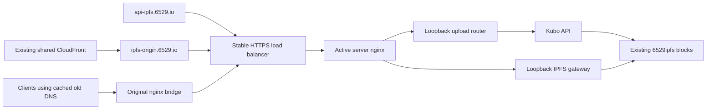

# Production IPFS infrastructure and deployment

IPFS has one environment: production. `ipfs-prod` is the protected GitHub Actions
environment for deployment authority; it does not create another IPFS environment.
A replacement server is an unpublished production candidate until it has restored
and verified the existing content and metadata.

Stage 1 completed on November 11, 2026. CloudFormation owns the original bucket,
EC2 instance, security group and shared CloudFront distribution. The exact import,
source, checks and workflows are in [adoption-record.json](adoption-record.json).
The import stack is retained, termination protected and frozen against resource
updates. Its temporary CloudFront provider permission window is closed.

Stage 2 adds runtime replacement through the explicit **Manage production IPFS**
workflow. A merge starts no deployment. The checked-in runtime switch permits
reviewed main-branch dispatches; the one-time ownership import remains disabled.
The first live migration must finish before runtime ownership can be reported as
active. Its result and retained rollback host must be recorded after verification.

## What describes what

These are ordinary CloudFormation YAML templates, passed directly to AWS. Python
reads them; it does not generate infrastructure descriptors.

| File                                      | Owns/describes                                                                                                                                    |
| ----------------------------------------- | ------------------------------------------------------------------------------------------------------------------------------------------------- |
| `cloudformation/adoption.yaml`            | The unchanged original bucket, server, security group and entire shared CDN                                                                       |
| `cloudformation/adoption-access.yaml`     | The separate, closed import authority                                                                                                             |
| `cloudformation/recovery.yaml`            | Private encrypted, versioned recovery/artifact buckets and access logs                                                                            |
| `cloudformation/runtime-access.yaml`      | GitHub OIDC deployment role, CloudFormation service role, runtime permission boundary and recovery access restricted to the original EC2 instance |
| `cloudformation/frontdoor.yaml`           | Stable HTTPS ALB, two writer/gateway slots, existing wildcard certificate reference and active-writer health alarm                                |
| `cloudformation/runtime.yaml`             | A new immutable server, encrypted retained disk, restricted HTTPS security group, IAM role and EC2 status-check alarm                             |
| `environments/production-deployment.json` | Reviewed account, VPC/subnets, AMI, original resource IDs and certificate references                                                              |
| `versions.json`                           | Pinned Kubo, Go, S3 plugin and nginx versions/checksums                                                                                           |

`production.py` orchestrates CloudFormation change sets, versioned artifacts, SSM,
state transfer, checks and the two canonical DNS changes. `production_host.py`
installs or verifies a candidate, backs up private recovery material, and performs
logical pin/MFS transfers on the explicitly identified host. `common.py` supplies
validation, source guards, checksums, private file writes and safe archive handling.
`handover_state.py` unions pins and replaces mutable file state only while its
public writes are fenced. These scripts do not create CloudFormation templates.

`control.py` and `access/storage/compute/edge.yaml` are the earlier isolated
candidate tooling retained for offline recovery contracts. The production workflow
uses `production.py` and the production templates above. The isolated path still
rejects the live bucket, original server and canonical DNS names.

## Production request path

The shared CDN configuration, media/Arweave/S3 behaviors and public IPFS hostnames
stay the same. The ALB/nginx routes preserve forwarded viewer Host headers for
all existing IPFS and media aliases. Only `api-ipfs.6529.io` and `ipfs-origin.6529.io` A records are
UPSERTed to ALB aliases. Route53 record sets cannot use the Stage 1 import path;
these two transitions are controller-managed, with exact names/types/actions
restricted in IAM. All other new AWS resources are native CloudFormation resources.
There is no DNS delete/recreate gap.

ALB terminates public TLS using the existing issued wildcard certificate. Targets
use HTTPS on port 443. ALB supports private/self-signed target certificates; the
upload router independently validates the pinned certificate and canonical peer
hostname when forwarding directly between servers. The replacement exposes no
public SSH, API port 5001 or gateway port 8080. Its public IPv4 supplies outbound
access in the existing public subnet; inbound HTTPS is restricted to the ALB and
previous writer security groups. Public TCP port 4001 preserves the original IPFS
peer service; UDP swarm ports, SSH, raw RPC and the raw gateway stay closed.
Every managed runtime also joins a stable private peer security group. Its only
ingress is HTTPS from that same group, allowing both directions of later handovers
and rollbacks. The original server's security group remains unchanged. Before DNS
or traffic changes, both writers must verify the other's private HTTPS path and
certificate; the peer addresses must be inside the reviewed production subnets.

The original nginx bridge distinguishes ALB/local traffic by the original socket
peer. Cached-DNS requests go to the ALB; requests arriving from the ALB stay local,
preventing loops. Forwarded client addresses and router hop headers are trusted
only from configured network peers. Public uploads retain the 50MB size limit and
6/minute rate limit, applied once at the serving path.

## How a migration works

Dispatch `.github/workflows/ipfs-manage.yml` on `main` with its exact reviewed full
SHA, `operation=migrate` and a new deployment ID of 3-12 lowercase letters/digits/
dashes. There are no arbitrary template parameters, instance selectors or DNS
names in the workflow inputs.

1. Build the pinned binary/plugin/router/nginx release on the runner. Rehearse
   recovery, restricted HTTPS, cached-DNS bridging, upload forwarding, draining,
   mutable-write waiting and bidirectional pin/MFS reconciliation without AWS data.
2. Verify the full shared CDN configuration against the adopted baseline. Back up
   the current logical state and private identity/configuration before host edits.
3. Create an unpublished ALB if needed, then a new retained runtime from YAML.
   Its role initially has only Get/List access to the live S3 blocks. Bootstrap
   installs current OS security updates; public TCP peering remains closed until
   the reboot gate passes. Give it an
   independent peer identity; never copy the serving peer's private identity.
4. Restore every explicit recursive/direct pin and name. Recursive restoration
   traverses the actual DAG, and the immutable MFS root must be readable. The
   pinned plugin's reviewed `s3-read-only.patch` accepts repeated initialization
   writes only when existing bytes match; it performs no S3 Put/Delete. IAM
   separately withholds block writes throughout this validation.
5. Change only the candidate role to permit block Put, restart only that candidate,
   restore its initial MFS while mutable uploads remain fenced, and verify actual
   upload/pin/read, restricted RPC, HTTPS and ranges. Reboot it and verify persisted
   data, version and writer fence before production traffic reaches it.
6. Install the source upload router and nginx bridge after the private backup.
   Wait for pre-reload nginx workers to finish: their accepted uploads bypass the
   router and must finish before the final source snapshot. Verify all four target
   groups and perform an upload/read through the inactive ALB validation rule.
7. Move the two canonical DNS records to the stable ALB while it still serves the
   current writer. The old nginx bridge continues serving cached-DNS clients.
8. Fence the source writer: already accepted local uploads finish there; subsequent
   uploads forward synchronously to the replacement. Ordinary immutable uploads
   continue. Uploads using `to-files` wait at the replacement until the source's
   final MFS directory is copied. Union the final pins without removing any new
   destination pins, then open mutable writes and switch only ALB rule weights.
9. Verify real public uploads through the API and all IPFS/CDN gateway aliases.
   Perform a real reverse handover to prove rollback preserves new uploads, then
   promote the replacement again with the same protocol. Verify both health alarms.

The old EC2 instance, daemon, disk and private recovery archive remain available
for rollback. The old nginx also serves the cached-DNS bridge. Migration does not
terminate it, delete blocks, run garbage collection or alter the frozen import
stack. Later retirement is a separate explicit operation.

## Operations and recovery

| Operation  | Effect                                                                          |
| ---------- | ------------------------------------------------------------------------------- |
| `plan`     | Offline reviewed-source plan; no AWS authentication or changes                  |
| `migrate`  | Complete validated replacement and real rollback/promotion rehearsal            |
| `verify`   | Verify the currently active writer, public upload/read and unchanged shared CDN |
| `backup`   | Private recovery archive plus checksummed/versioned logical transfer            |
| `rollback` | Reconcile new writes back to the retained previous writer, then switch weights  |
| `promote`  | Reconcile writes to the replacement again, then switch weights                  |

Use the existing deployment ID for verification/backup/rollback/promotion. Those
operations can run from a newer reviewed main commit while continuing to reference
the original exact release artifact. A new migration requires a new ID/source.
To resume an interrupted migration, rerun its original Actions run so its reviewed
source SHA remains identical. A repeated rollback to an already active writer only
verifies it; it never copies stale state over that writer.

Versioned journals live in `prod/deployments/<id>.json`. They record change-set
ARNs and command IDs before waiting. An Actions timeout does not cancel AWS/SSM.
Inspect the recorded operation and resume it; never delete retained data or a
partially initialized repository to make a retry work. An incomplete installation
requires inspection or a fresh candidate. Pin/MFS transfer has a durable journal
and can resume with the same source snapshot and writer epoch.

Router state persists on disk and its control socket is root-only. Epoch checks
reject stale controllers. Before final metadata transfer, source accepted uploads
must have drained and destination mutable writes must remain fenced. Both old and
new immutable roots/pins survive reconciliation. Garbage collection and block
Delete permissions are excluded from the managed runtime.

Private archives include source config, keys, nginx/systemd and TLS recovery
material. They remain in encrypted private S3 prefixes, separate from the transfer
objects a candidate can read. GitHub receives only public identifiers, versioned
object references, counts and verification results. Host failures write restricted
local diagnostics; never publish raw config, identity or command output.

## Authority and bootstrap

Bootstrap the recovery and runtime-access stacks from the reviewed YAML using an
authorized operator, inspecting their native change sets first. Enable termination
protection. Do not broaden or reopen the Stage 1 import roles. Recovery creates
only new private buckets; the original EC2 role gets recovery access conditioned
on the original instance ARN.

The existing `ipfs-prod` GitHub environment must remain restricted to `main` and
provide `IPFS_RUNTIME_ROLE_ARN` and `IPFS_RUNTIME_SERVICE_ROLE_ARN` from the access
stack outputs. Authentication uses OIDC, never stored AWS access keys. The IAM
subject prefix must match the repository's actual GitHub OIDC subject format.

CloudFormation updates reject resource removal/replacement. Runtime write access
changes only the candidate role. Registering a candidate can change only the
inactive target groups; switching traffic can change only listener weights and
the active-writer alarm. Network/certificate changes require another review.
Termination protection and retained disks/buckets complement those restrictions.

ALB and recovery-bucket access logs go to a separate private log destination;
recursive logging on that destination is disabled per AWS guidance. CloudWatch
alarms track active-writer and EC2 health. They are visible in AWS; no SNS/email
notification destination is introduced by this deployment.

No Lambda, backend API or frontend deployment is needed.

References: [CloudFormation import](https://docs.aws.amazon.com/AWSCloudFormation/latest/UserGuide/import-resources-manually.html),
[ALB rule edits and in-flight requests](https://docs.aws.amazon.com/elasticloadbalancing/latest/application/edit-rule.html),
[ALB target TLS](https://docs.aws.amazon.com/elasticloadbalancing/latest/application/load-balancer-target-groups.html),
[ALB logging](https://docs.aws.amazon.com/elasticloadbalancing/latest/application/enable-access-logging.html),
[S3 logging](https://docs.aws.amazon.com/AmazonS3/latest/userguide/enable-server-access-logging.html),
[GitHub OIDC](https://docs.github.com/en/actions/how-tos/secure-your-work/security-harden-deployments/oidc-in-aws).
